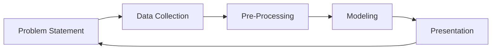

Data Analytics チームのミッションは、信頼性が高くスケーラブルなデータソリューションでビジネス上の意思決定と戦略のインパクトを**最大化**することです。

私たちは、すべての GitLab チームが[**データ成熟度**](https://internal.gitlab.com/handbook/enterprise-data/direction/#current-data-maturity)を高められるよう、**私たちの** **GitLab バリュー**と[**Data Team の原則**](/handbook/enterprise-data/organization/principles/)を通じて支援することで、これを実現しています。

## Data Analytics の責務 {#data-analytics-responsibilities}

**Data Analytics チーム**は以下の事項に**直接責任**を持ちます:

- 会社の主要業績評価指標（KPI）の定義・データベース・データビジュアライゼーションを管理・ガバナンスする
- データビジュアライゼーション・データモデリング・データ品質・データ統合を含むカスタマイズ可能なデータサービスを提供する
- データ・アナリティクスシステムに関連するガバナンス・リスク・コンプライアンスプログラムを支援する

さらに、**Data Analytics チーム**は以下の責務を支援します:

- **Data Leadership Team**と連携して:
  - GitLab のデータアセットの価値を最大化するためのデータ戦略を策定・公開する
  - データ成果物・進行中のイニシアティブ・今後の計画について定期的な更新情報を発信する
- [**Data Platform Team**](/handbook/enterprise-data/organization/engineering/#data-platform-responsibilities)と連携して:
  - すべての GitLab チームのレポーティング・分析・ディメンショナルモデリング・データ開発を支援する会社の中央エンタープライズデータウェアハウスを構築・維持する
  - マスターデータ・参照データ・データ品質・データカタログ・データ公開などのデータ管理機能を開発する
  - すべての人がデータとアナリティクスを活用できるセルフサービスのデータ機能を提供する
  - GitLab のデータシステムにおけるデータ品質の実践とプログラムを定義・推進する

## Data Analytics チームにおけるハンドブックファースト {#handbook-first-on-the-data-analytics-team}

GitLab では[ハンドブックファースト](/handbook/about/handbook-usage/#why-handbook-first)を実践しており、以下の方法で推進しています:

1. ビジネスパートナー（すべての GitLab チームメンバー）が最新かつ正確な情報でハンドブックを更新できるよう支援する。
1. コンテンツをレビューし、データの機密性とセキュリティを考慮しつつ、ハンドブック内の情報がデータを適切に反映していることを確認する。
1. Data Team のハンドブックセクションを更新する
    - エキサイティングな Data Analytics コンテンツを追加する
        - 今後のコンテンツ例: `Data Visualization: Tips and Tricks` や `Data Storytelling`
    - Data Team のプロセスやコードベースの変更を反映する（より良いプロセスやコードについては私たちも非常に興奮しています！誰でもそうですよね！）

---

## アナリティクスとは何か、なぜ実施するのか？ {#what-is-analytics-and-why-do-we-do-it}

**アナリティクス**とは**データ**を**情報・知識・知恵**に変換する実践であり、以下の目的のために行います:

1. **効率の改善とコスト回避**
    1. 人的資本 - ロケーションファクター・オファー受諾率・採用コスト
    1. 財務 - ARR・新規パイプライン創出・クレジットカード失敗率
    1. 販売チャネル - 勝率・サービス付帯率
    1. マーケティング - 創出した商談・製品ダウンロード数
1. **ビジネスモデルの改善**
    1. アナリティクス計測 - サインアップ成長・提供した新機能・主要機能
    1. 顧客アナリティクス - ファーモグラフィクス・導入傾向・利用状況と契約の比較
    1. 顧客購買トレンド - 更新・アップグレード・ダウングレード
1. **顧客体験の改善**
    1. データプロダクト - 業界ベンチマーク・データ API・アルゴリズム
    1. データを活用したプロセス改善
    1. 製品内インサイト

## データ分析プロセス {#data-analysis-process}

Data Analytics・上級 Data Analytics・データサイエンスはすべて `Data Analysis Process` から始まります。

`Data Analysis Process` は 5 つのステップで構成されています:

Data Analytics において、文脈がすべてです。文脈は、Data Analyst が問題・データ・データインサイトを生成するための手法をどのように捉えるかを方向付けます。

### 問題提起 {#problem-statement}

`Problem Statement` ステップでは、ビジネスパートナーとともに**ビジネス課題を明確に定義する**ことが不可欠です。ビジネスパートナーが求めているデータインサイトのビジネス課題を明確に定義することで、Data Analyst は成功基準を設定し、問題が**利用可能なデータで技術的に解決可能か**どうかを確認し、問題に対する**最大のビジネスインサイト**を提供できるようになります。

### データ収集 {#data-collection}

`Data Collection` ステップでは、Data Analyst が分析のインパクトや一般化を制限する可能性のある**データ上の注意点**を探索・理解し、**データバイアス**や**データ上の懸念点**を評価することが重要です。各ビジネスシステムでデータがどのように収集されているかを理解することで、適切な方法で正確なデータをレポーティングできます。このステップでは、信頼性の高い変換のために**データ型**が正確であることを確認することが重要です。

このため、このステップはソースシステム担当者とのフィードバックループの一部でもあります。Data Team メンバーがデータフィールドが `missing` または `inaccurately captured` と判断した場合、GitLab の誰もがソースシステム担当者に連絡し、対象のデータフィールドの更新または追加を依頼することが責務となります。

### 前処理 {#pre-processing}

`Pre-Processing` ステップでは、Data Analyst がデータを準備・クレンジングし、データ品質を検査して、スケーラブルなレポーティングのための最適な**データ構造**を設計します。このステップでは、モデルをレビューしてビジネスにわかりやすいモデルであることを確認することが重要です。

### モデリング {#modeling}

`Modeling` ステップでは、すべての GitLab チームメンバー向けに[エンタープライズディメンショナルモデル](/handbook/enterprise-data/platform/edw/)形式で新しいデータモデルを作成することを目指します。新しいデータ構造が正確なビジネスプロセスを反映していることを確認するために、まず **エンティティ関係図（ERD）** から始めます。すべてのデータモデルは[Data Platform Team](/handbook/enterprise-data/organization/engineering/#data-platform-responsibilities)によってレビューされます。

### プレゼンテーション {#presentation}

`Presentation` ステップでは、Data Analyst が強力な**データビジュアライゼーション**を駆使した**データストーリーテリング**の能力を発揮します。Data Analyst は、[実用的なビジネスインサイトをパッケージ化してステークホルダーに効果的に伝えることが重要](https://www.forbes.com/sites/evamurray/2019/01/28/how-data-visualization-supports-communication/#3a8d1972cced)であることを認識しています。実際、ビジネスパートナー（すべての GitLab チームメンバー）がデータを信頼できるよう、詳細な根拠を示すドリルダウン付きのビジネスインテリジェンス（BI）ダッシュボードなどのデータソリューションが強固なデータ品質チェックを持つことと同様に重要です。

Data Analytics の素晴らしい点は、各インサイトが追加のビジネス上の問いの連鎖を生み出すべきであり、それによって `Data Analysis Process` が再びサイクルすることができるという点です。
