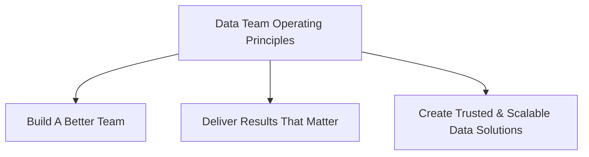

---

## データ管理原則 {#data-management-principles}

**私たちのデータに関する意思決定は、10 のエンタープライズデータ管理原則によって導かれ、整合されています。

### データの価値を最大化する {#maximize-the-value-of-data}

- 私たちはデータを、リスク管理を含む他の認識された（有形・無形の）資産と同様の規律をもって管理する**共有戦略的資産**として扱います。
- **データは組織に帰属するもの**であり、チームや個人のものではありません。
- 私たちはデータインサイト、推奨事項、ソリューションを通じて**イノベーション**を推進します。

### データ保護とプライバシー {#data-protection--privacy}

- 私たちは GitLab のデータが**適切に保護**されていることを確保します。
- 私たちはデータプロダクトを**透明な方法**で管理します。
- 私たちはデータの役割、責任、標準、ポリシーを明確にする**データガバナンス**の実践を実施しています。

### データ管理 {#data-management}

- 私たちは作成から保存、変換、利用、アーカイブ、削除に至る**完全なデータのライフサイクルを管理**します。
- **業務機能がデータの品質に対する所有権と説明責任を持ちます**。
- 私たちはデータが**発見可能、追跡可能、分類された状態**であることを確保します。
- 私たちはデータの**品質を積極的に設計・管理**します。

## データ＆インサイト運営原則 {#data--insights-operating-principles}

**私たちは、世界で最も革新的な企業の一つにおいて、データ＆インサイトの卓越センターであることを誇りに、そして謙虚に受け止めています。**

**Data Team の運営原則**は 3 つあります。

### より良いチームを構築する {#build-a-better-team}

- [CREDIT](/handbook/company/operating-principles/#acknowledging-credit)
- 私たちは全員を尊重して接します
- 私たちは GitLab の成功に向けた最善の意図を前提とします
- 私たちは自分自身と互いに対して誠実です
- 私たちは反対意見を述べる権利がありますが、コミットメントに向けて進まなければなりません
- 私たちは困難な会話から逃げません
- 私たちはチームとして一緒に取り組みます
- 私たちはチームとして間違いに向き合い、改善を目指します

### 重要な成果を届ける {#deliver-results-that-matter}

- データドリブンを第一に、データインフォームドを第二に、原則とストーリーを第三に
- 私たちは速く作りすぎるのではなく、長持ちするものを作ることを信じています
- 私たちは[成長マインドセット](https://hbr.org/2016/01/what-having-a-growth-mindset-actually-means)で継続的に基準を高めながら運営します
- 私たちは活動と進歩を混同しません
- 私たちは自分たちの仕事が戦略的イニシアチブとどのように連動しているか、また Business Partners が影響力のある成果を届けるためにどのように役立つかを理解しています
- 私たちはコンテキスト、事実、インサイトを提供するために一歩踏み込みます
- 私たちは事前に期待値を定義します。スコープ、期間、成功基準
- 私たちは重要なイニシアチブにおいて定期的な進捗を確保するために Business Partners と積極的に連携します

### 信頼できるスケーラブルなデータソリューションを作る {#create-trusted--scalable-data-solutions}

- 私たち全員がデータセキュリティとデータ品質に対する責任を持ちます
- 私たちは十分にテストされた正確なデータソリューションを先頭に立てて進めます
- 私たちは自分たちが作った本番ソリューションを運用・維持します
- 私たちは今日の GitLab への提供をしながら、2 年後の GitLab のために設計します
- 私たちはベンダーパートナーの機能とサービスを最大限に活用します
- 私たちは複雑な成果を整合させる最良の方法はそれを可視化することだと信じています
- 自動テストが最良のテストであり、私たちはデータ提供プロセスのあらゆるステップでテストを実装します

### Data Team が抱える追加の信念 {#additional-beliefs-held-by-the-data-team-include}

- あらゆるものはコードで定義され、バージョン管理されるべきです
- データ実装はワークフローに DevOps のベストプラクティスを統合するべきです
- 高品質で保守可能なコードベースを持ちながら、各業務機能とパートナーシップを築きます
- データのセキュリティとデータの機密性を念頭に置きながら、コードをオープンソース化します
- 企業内のあらゆる分析的な質問に対する唯一の真実のソースが存在し、最も包括的なデータインサイトを提供するために複数の視点を示すことも重要です
- [グルーワーク](https://www.locallyoptimistic.com/post/glue-work/)はチームの健全性にとって重要であり、それが提供する価値において個別に認められます。私たちは誰もが貢献することを期待します。
- データが最も大きな影響を与える場所に限られたリソースを集中させます
- すべてのビジネスユーザーは、簡単な統計の解釈と計算方法を学べるべきです

---
