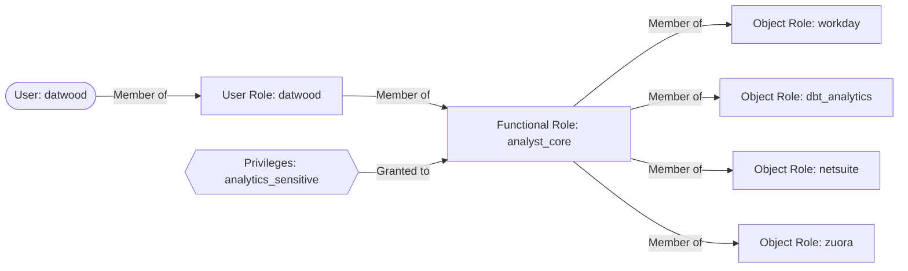
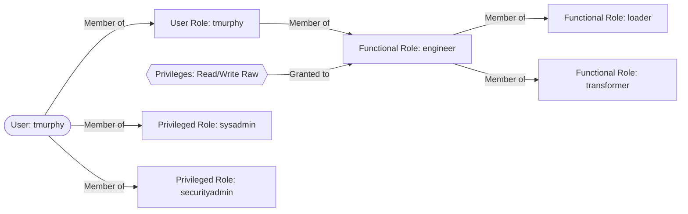
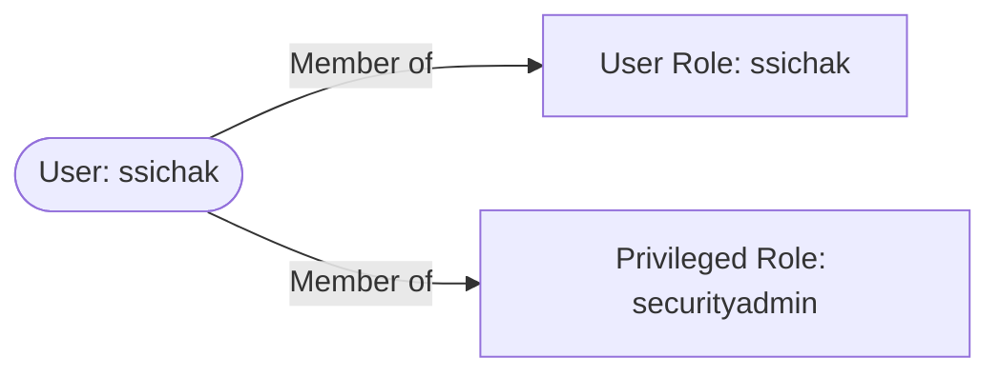
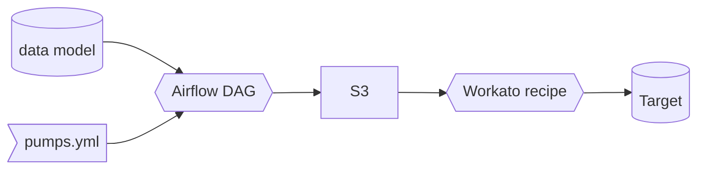

## データプラットフォームのビジョン {#our-data-platform-vision}

これらの野心は、GitLab のデータプラットフォームのためのガイドビジョンとなるよう設定されています。

### 貢献しやすくする {#makes-it-easier-to-contribute}

GitLab のデータプラットフォームへの貢献は簡単であり、プラットフォームの使用は直感的です

* ドキュメンテーションは完全で、ユーザーと貢献者にとって関連性があります
* すべてのデータ変換は dbt で実装されます
* CI/CD は、貢献者とレビュアーにとってシームレスで、直感的で、自動化されています
* データの状態は、ソースと変換から派生します
* データパイプラインはべき等です

### 信頼性が高い {#is-reliable}

データプラットフォームとそれが提供するデータは、可用性と精度の点で一貫しています

* すべての破壊的変更は、Dev および／または Staging 環境でテスト可能です
* 自動化されたテストはデータデリバリープロセスのすべての段階で実装されます
* プラットフォームのすべてのコンポーネントは、コードで定義してバージョン管理でき、そうすべきです

### セキュアである {#is-secure}

データプラットフォームは人々を危険にさらしません

* データは、文書化された承認により認可された人のみがアクセスできます
* GitLab データチームは、認可と認証に関して [最小権限の原則](https://internal.gitlab.com/handbook/security/access-management-standard/#principle-of-least-privilege)に固執します

### メンテナンスしやすい {#is-maintainable}

* データプラットフォームコンポーネントは、[メンテナビリティの容易さ](https://en.wikipedia.org/wiki/Maintainability)のための良いエンジニアリングプラクティスを考慮して作成されます。これは、メンテナビリティの追跡が、システムが「コードのエントロピー」または整合性の低下に向かう傾向を減らすか逆転させるのに役立つことを意味します

### より大きなコミュニティに利益をもたらす {#benefits-a-larger-community}

GitLab のデータプラットフォームは、GitLab 以上のコミュニティに関連性があり、より大きなエンジニアコミュニティに依存しています。

* 関連するプラットフォームコードはオープンソースです
* プラットフォームの強化は、コミュニティプロジェクトに還元されます
* 私たちは特異な独自開発よりも、一般化可能な仕様と標準を好みます

## 目的 {#purpose}

データプラットフォームはデータ分析の目的に使用されます。このドキュメントは、データプラットフォームとして総称的に定義されるコンポーネントを概念的に高レベルで説明します。

## スコープ {#scope}

このドキュメントは、データプラットフォームを概念的に説明することに限定されます。それをより詳細に説明する他のリソースがあります（例: [データパイプライン](/handbook/enterprise-data/platform/pipelines/)と [インフラストラクチャ](/handbook/enterprise-data/platform/infrastructure/)）。

## 役割と責任 {#roles--responsibilities}

| 役割 | 責任 |
| ---- | -------------- |
| GitLab チームメンバー | データプラットフォームを形成する標準にどう注意を払うかについての責任 |
| Data Platform Team Members | この標準に基づいてデータユースケースを実装および実行する責任 |
| Data Management Team | この標準に対する重要な変更と例外を承認する責任 |

## 標準 {#standards}

## <i class="fas fa-map-marked-alt fa-fw -text-purple"></i>クイックリンク {#quick-links}

* [Data Enablement](/handbook/enterprise-data/platform/data-enablement/)
* [データインフラストラクチャ](/handbook/enterprise-data/platform/infrastructure/)
* [データパイプライン](/handbook/enterprise-data/platform/pipelines/)
* [データ CI ジョブ](/handbook/enterprise-data/platform/ci-jobs/)
* [dbt ガイド](/handbook/enterprise-data/platform/dbt-guide/)
* [Enterprise Data Warehouse](/handbook/enterprise-data/platform/edw/)
* [Data Pump](/handbook/enterprise-data/platform/#data-pump)
* [インシデント管理](/handbook/enterprise-data/data-governance/incident-management/)
* [Jupyter ガイド](/handbook/enterprise-data/platform/jupyter-guide/)
* [Permifrost](/handbook/enterprise-data/platform/permifrost/)
* [Python ガイド](/handbook/enterprise-data/platform/python-guide/)
* [Python／ツールのパッケージ管理と一覧](/handbook/enterprise-data/platform/python-tool-package-management/)
* [Snowflake](/handbook/enterprise-data/platform/snowflake/)
* [Snowplow](/handbook/enterprise-data/platform/snowplow/)
* [SQL スタイルガイド](/handbook/enterprise-data/platform/sql-style-guide/)
* [R/RStudio](/handbook/enterprise-data/platform/rstudio/)
* [Tableau](/handbook/enterprise-data/platform/tableau/)

## <i class="fas fa-cubes fa-fw -text-orange"></i>データスタック {#our-data-stack}


私たちは、分析機能を運用および管理するために GitLab を使用しています。
すべては Issue から始まります。
変更は、パイプライン、抽出、ロード、変換、および分析の一部への変更を含めて、マージリクエストを通じて実装されます。

| ステージ           |              ツール             |
| :-------------- | :---------------------------: |
| 抽出      | Stitch、Fivetran、Tableau Prep、カスタムコード |
| ロード         | Stitch、Fivetran、Tableau Prep、カスタムコード |
| オーケストレーション   | Airflow, Tableau Prep |
| データウェアハウス  | Snowflake Enterprise Edition |
| 変換 | dbt と Python スクリプト |
| データの視覚化 | Tableau |
| 高度な分析 | jupyter |

## <i class="fas fa-exchange-alt fa-fw -text-purple"></i>抽出とロード {#extract-and-load}

私たちは現在、一部のデータソースで [Stitch](https://www.stitchdata.com)と [Fivetran](https://www.fivetran.com/)を使用しています。これらは、一部のデータソースから当社の Snowflake データウェアハウスへのデータの移動の構築、メンテナンス、オーケストレーションの責任を取り除く、オフザシェルフの ELT ツールです。

Stitch と Fivetran は、データパイプラインの開始を自分自身で処理します。これは、Airflow が Stitch および Fivetran スケジュールのオーケストレーションで役割を果たさないことを意味します。

データを抽出するために使用する他のソリューションは以下です:

1. [Python](/handbook/enterprise-data/platform/python-guide/)で構築され、[Airflow](/handbook/enterprise-data/platform/infrastructure/)を介してオーケストレーションされるカスタムパイプライン
1. Tableau Prep で構築され、Tableau Cloud によってオーケストレーションされるフロー
1. Snowflake [データ共有](https://docs.snowflake.com/en/user-guide/data-sharing-intro)

ソースの所有者については、[Tech Stack Applications](/handbook/business-technology/tech-stack-applications/)を参照してください。

### データソース {#data-sources}

以下の表は、外部の場所からデータウェアハウスにロードしているすべての RAW データソースをインデックス化しています。私たちは [New Data Source/Pipeline Project Management](https://docs.google.com/spreadsheets/d/14uqsAIqRnyyL9Ta39QYwheXnf0k86yTTIKhrkY_1el8/edit#gid=0)シートで開発バックログと優先順位を管理し、最新のステータスと進捗管理のための GitLab Issue へのリンクがあります。[新しいデータソースのハンドブック](/handbook/enterprise-data/how-we-work/new-data-source/)ページでは、データチームが新しいデータソースのリクエストを処理する方法を説明しています。

**以下の表のパイプラインの列のリンクは、該当する場合、特定のデータパイプラインの詳細ページに移動します。**

**キー**

* パイプライン: データを複製するために使用する技術。
* RF（複製頻度）: 新規および更新されたデータをロードする頻度。
* Raw スキーマ: データが保存されている `RAW` データベースのスキーマ。
* Prep スキーマ: [ソースモデル](/handbook/enterprise-data/platform/dbt-guide/#source-models)がマテリアライズされる `PREP` データベースのスキーマ。
* 利用者: データの主要なユーザー。
* SLO: サービスレベル目標。私たちの SLO は、リアルタイムと消費のために利用可能になったデータの間の時間です。
  * 技術的には、これは上流システムにエントリが作成されたときから、データが Snowflake の `PROD` レイヤーで利用可能になるまでの時間を意味します（これには、dbt 内の変換が含まれます）。
`x` は未定義または実行されないことを示します

{}
<!-- Add or edit data sources in https://gitlab.com/gitlab-com/www-gitlab-com/-/blob/master/data/data_warehouse_sources.yml -->

#### ソースの連絡先 {#source-contacts}

外部エラーがある場合に誰に連絡するかについては、[ソースの連絡先スプレッドシート](https://docs.google.com/spreadsheets/d/1VKvqyn7wy6HqpWS9T3MdPnE6qbfH2kGPQDFg2qPcp6U/edit)を参照してください。

#### Tier の定義 {#tier-definition}

| アスペクト | Tier 1 | Tier 2  | Tier 3 |
|:-|:-|:-|:-|
| **説明**  | - 最も重要でビジネスクリティカルな信頼されたデータソリューション。<br><br> - 日々の運用を確保するために、コンポーネントが利用可能でリフレッシュされる必要があります | - 洞察を集めるために重要で有益なデータソリューション。<br><br> - コンポーネントは、日々の運用をサポートするために利用可能でリフレッシュされている必要があります | - アドホック、定期的、または一度きりの分析に重要なデータソリューション。<br><br> - コンポーネントは利用できない、またはデータがリフレッシュされない可能性があります。 |
|**基準**|- 24 時間利用できない場合に $100k *以上*のビジネスインパクトをもたらす任意のデータ、プロセス、または関連サービス <br><br>-  15 人を超えるビジネスユーザーに影響を与える | - 24 時間利用できない場合に$100k *未満*のビジネスインパクトをもたらす任意のデータ、プロセス、または関連サービス <br><br> - 5〜15 人のビジネスユーザーに影響を与える | - 5 営業日を超えて利用できない場合に即時のビジネスインパクトをもたらさ*ない*任意のデータ、プロセス、または関連サービス <br><br> - 5 人未満のビジネスユーザーに影響を与える |
|**停止による影響**|重大|寛容|無視できる |
| **モニタリングとオブザーバビリティ** | 鮮度と量の異常について Monte Carlo を通じて監視。すべてのアラートが調査され、必要に応じて、上流（システム／データ）所有者にエスカレートされます。 | データパイプラインの継続性のために、Monte Carlo を通じて技術的に鮮度が監視されます。アラート時に、技術的な失敗が調査されます。 | データパイプラインの継続性のために、Monte Carlo を通じて技術的に鮮度が監視されます。アラート時に、技術的な失敗が調査されます。  |

**モニタリングと根本原因調査に関するメモ:** トリアージャーは、データコンテキスト（タイプ、ボリューム、履歴パターン）を評価して、上流（システム／データ）所有者との調査および／またはエスカレーションが必要かどうかを判断するべきです。チームメンバーは、データのコンテキストを考慮するべきです。以下は規範的ではありませんが、緩やかに従われるパラダイム（例、他も適用されます）として機能します: データソースが 1 日あたり 1M レコードを受信していたのに、パイプラインが実行されているのに突然データを受信しなくなった場合、これは必ずしもデータパイプラインに関連していない上流の問題を示しているため、調査が必要です。ただし、データソースが 1 日あたり 10 レコードを受信していたのに、特定の日付（例: 1 月 1 日）で 2 レコードに低下した場合、これは履歴パターンに基づく期待される行動である可能性があるため、調査は必要ない可能性があります。

### データソースへのデータチームのアクセス {#data-team-access-to-data-sources}

新しいデータソースをデータウェアハウスに統合するため、データチームの特定メンバーは、UI と API の両方でデータソースへの管理者レベルのアクセスが必要です。
適切な分析を構築するために必要なすべてのデータを取得するために API を通じて、また準備された分析の結果を UI と比較するために UI を通じて、この管理者レベルのアクセスが必要です。

機密データソースは、必要なレポートを構築するために、少なくとも 1 人のデータエンジニアと 1 人のデータアナリストがアクセスを持つように制限できます。
場合によっては、2 人のデータエンジニアのみになる可能性があります。
自動化された抽出プロセスのために追加のアカウントをリクエストする可能性があります。

機密データは、以下にリストされたセキュリティパラダイムを通じてロックダウンされます。

### データソース概要 {#data-source-overviews}

* [Customer Success Dashboards](https://drive.google.com/open?id=1FsgvELNmQ0ADEC1hFEKhWNA1OnH-INOJ)
* [Netsuite](https://www.youtube.com/watch?v=u2329sQrWDY)
  * [Netsuite and Campaign Data](https://drive.google.com/open?id=1KUMa8zICI9_jQDqdyN7mGSWSLdw97h5-)
* [Version (pings)](https://drive.google.com/file/d/1S8lNyMdC3oXfCdWhY69Lx-tUVdL9SPFe/view)
  * 2019 年 10 月まで、データチームは **version** データソース全体を "pings" と呼んでいたことに注意してください。ただし、usage ping は version データソースの 1 つのサブセットに過ぎないため、version または version app を使用して version.gitlab.com の *データソース* を参照し、"usage data"、"usage pings"、または "pings" を使用して version データソースの [特定の使用データ機能](https://docs.gitlab.com/ee/administration/settings/usage_statistics.html)を参照しています。データ抽出のコンテキストで、`Service ping` データインジェスチョンに関する場合、特定の詳細は [Service ping](https://internal.gitlab.com/handbook/enterprise-data/platform/pipelines/#service-ping)ページまたは Service ping の [Readme.md](https://gitlab.com/gitlab-data/analytics/-/blob/master/extract/saas_usage_ping/README.md)ページで見つけることができます
* [Salesforce](https://youtu.be/KwG3ylzWWWo)
* [Zendesk](https://drive.google.com/open?id=1oExE1ZM5IkXcq1hJIPouxlXSiafhRRua)

### Snowplow インフラストラクチャ {#snowplow-infrastructure}

セットアップに関する詳細については、[Snowplow インフラストラクチャのページ](/handbook/enterprise-data/platform/snowplow)を参照してください。

## <i class="fas fa-robot fa-fw -text-blue"></i>AI {#ai}

私たちはデータプロダクトの開発に AI を使用し、データプロダクトで AI を使用します。

### データプロダクトを開発するための AI の使用 {#using-ai-to-develop-data-products}

私たちは、GitLab Duo Agentic Platform（詳細は [内部ハンドブックのページ](https://internal.gitlab.com/handbook/enterprise-data/platform/ai_to_data/gitlab_duo_snowflake_mcp/)で）、Tableau データソース、Claude を Model Context Protocol（MCP）接続経由で Snowflake データウェアハウスに接続することで、データ開発プロセスを強化するために AI を活用しています。この統合により、開発ワークフローを加速し、データプロダクトの品質を向上させることができます。

### AI プロダクトの構築 {#building-ai-products}

私たちの AI プロダクト開発は、2 つの主要な領域に分類されます:

#### 1. Snowflake Cortex AI {#1-snowflake-cortex-ai}

私たちは、データプラットフォーム内で [Snowflake Cortex AI](https://www.snowflake.com/en/product/features/cortex/)を活用して、データウェアハウス内で直接ネイティブ AI 機能を提供しています。詳細な実装ガイダンスとベストプラクティスについては、[AI to Data に関する内部ハンドブックページ](https://internal.gitlab.com/handbook/enterprise-data/platform/ai_to_data/)を参照してください。

#### 2. フェデレーション AI ツール {#2-federated-ai-tools}

以下を含むフェデレーション AI ツールを実装しています:

1. **[Weaviate](https://weaviate.io/)**: データの高次元ベクトル表現を保存および照会することで、セマンティック検索と AI 駆動データ取得を可能にするベクトルデータベース
2. **外部 AI の統合**: 外部の大規模言語モデル（LLM）をベクトルデータベースインフラストラクチャに接続して、データプロダクト全体で高度な AI 機能を可能にします

## <i class="fas fa-clock fa-fw -text-orange"></i>オーケストレーション {#orchestration}

私たちは、オーケストレーションのために Kubernetes 上の Airflow を使用しています。具体的なセットアップ／実装は [こちら](https://gitlab.com/gitlab-data/data-image)で見つけることができます。詳細については、[データインフラストラクチャ](/handbook/enterprise-data/platform/infrastructure/)ページも参照してください。

## <i class="fas fa-database fa-fw -text-purple"></i>データウェアハウス {#data-warehouse}

私たちは現在、データウェアハウスとして [Snowflake](https://docs.snowflake.net/manuals/index.html)を使用しています。Enterprise Data Warehouse（EDW）は、GitLab の企業データ、パフォーマンス分析、主要業績評価指標などのエンタープライズ全体のデータに関する信頼できる唯一の情報源です。EDW は、レポート作成、ダッシュボード作成、分析のための共通のプラットフォームとフレームワークをすべてのチームに提供することで、GitLab のデータ駆動のイニシアチブをサポートします。ポイントツーポイントのアプリケーション統合を除き、現在および将来のすべてのデータプロジェクトは EDW から推進されます。さまざまな GitLab ソースシステムからのデータの受信者として、EDW はまた、すべての決定が可能な限り最高のデータを使用して行われることを確実にするために、データ品質のベストプラクティス、メジャー、修正を情報提供および推進するのに役立ちます。

### Snowplow の列の更新 {#snowplow-updating-columns}

#### Snowplow の位置情報列の NULL 化 {#snowplow-nullify-geo-columns}

**Issue**: [**Snowflake ドキュメント**](https://docs.snowflake.com/en/user-guide/data-load-snowpipe-ts#unable-to-reload-modified-data-modified-data-loaded-unintentionally)

Snowplow にジオデータを抽出しないために、以下の列が NULL 化されました:

* `geo_zipcode`
* `geo_latitude`
* `geo_longitude`
* `user_ipaddress`

この NULL 化は、`2023-02-01` から Snowplow に適用され、ファイルは同じ構造を持ち、列値だけが `NULL` に設定されています。データチームは古いファイルを更新して、言及された列を `NULL` に設定し、Snowflake でも列を `NULL` に設定しました。これは Snowflake の `RAW`、`PREP`、`PROD` レイヤーに適用されます。

[**Snowflake ドキュメント**](https://docs.snowflake.com/en/user-guide/data-load-snowpipe-ts#unable-to-reload-modified-data-modified-data-loaded-unintentionally)のとおりに `S3` バケットで更新されたファイルの重複ロードを避けるため、フォルダ構造は以下から変更されました:

```bash
- gitlab-com-snowplow-events/
    output/ <---- all files are located here
        2019/01/01
        ...
        (present day)
```

新しい構造に:

```bash
- gitlab-com-snowplow-events/
    output_nullified_columns/ <---- all files are nullified and updated
        2019/01/01
        ...
        2023/01/31
    output/ <---- new files will land here and will be loaded by Snowpipe
        2023/02/01
        ...
        (present day)
```

#### Snowplow の `page_url_path` 列の NULL 化 {#snowplow-nullify-page_url_path-columns}

**Issue**: [s3: Pseudonymize page_url_path in Snowflake and s3 bucket](https://gitlab.com/gitlab-data/analytics/-/issues/22351)

Snowplow に対するデータコンプライアンスのために、以下の列が仮名化されました:

* `page_url_path`

この仮名化は、`Snowplow` データに対して、期間 `2022-10-26` - `2024-12-01` で適用され、ファイルは同じ構造を持ち、列値だけが仮名化されています。
データチームは古いファイルを更新し、`page_url_path` 列を仮名化し、Snowflake でも `page_url_path` 列を仮名化しました。
これは Snowflake の `RAW`、`PREP`、`PROD` レイヤーに適用されます。

[s3: Pseudonymize page_url_path in Snowflake and s3 bucket](https://gitlab.com/gitlab-data/analytics/-/issues/22351)のとおりに `S3` バケットで更新されたファイルの重複ロードを避けるため、フォルダ構造は以下から変更されました:

```bash
- gitlab-com-snowplow-events/
    output_nullified_columns/ <---- all files are nullified and updated (in the previous iteration)
        2022/10/26
        ...
        2023/
            02/
    output/
        2023/
            02/
            03/
```

新しい構造に:

```bash
- gitlab-com-snowplow-events/
    output_nullified_columns/
        2019/01/01
        ...
        2022/10/25
    output_mask_page_url_path/ <---- all files are pseudonimized
        2022/10/26
        ...
        2023/12/01
    output/ <---- new files will land here and will be loaded by Snowpipe
        2023/12/02
        ...
        (present day)
```

> **注:** `S3` バケットへのすべての新しいロードは、以前と同じフォルダ `gitlab-com-snowplow-events/output` に入ります。

### Snowflake サポートポータルへのアクセス {#snowflake-support-portal-access}

**前提条件:**

* チームメンバーが Snowflake で検証済みのメールアドレスを持っている必要があります
* メール検証は Snowsight の Settings → My Profile で完了できます

**アクセスオプション:**

サポートポータルアクセスには 3 つの権限レベルがあります:

* `MANAGE ORGANIZATION SUPPORT CASES` - 組織全体のすべてのサポートケースを表示および管理
* `MANAGE ACCOUNT SUPPORT CASES` - アカウントのすべてのサポートケースを表示および管理
* `MANAGE USER SUPPORT CASES` - ユーザー自身がオープンしたケースを表示および管理

**アクセスポリシー:**

個別リクエストには常に MANAGE USER SUPPORT CASES から始めてください。より高いアクセスレベル（MANAGE ACCOUNT または MANAGE ORGANIZATION SUPPORT CASES）は、個別レベルのアクセスが不十分である理由を示すビジネス上の正当化が必要です。

**アクセスの付与:**

`ACCOUNTADMIN` のみが、MANAGE ACCOUNT SUPPORT CASES または MANAGE USER SUPPORT CASES 権限を付与できます。
`ORGADMIN` のみが、MANAGE ORGANIZATION SUPPORT CASES 権限を付与できます。

適切な付与ステートメントを実行します:

-- MANAGE USER SUPPORT CASES

```SQL
USE ROLE ACCOUNTADMIN;
GRANT MANAGE USER SUPPORT CASES ON ACCOUNT TO ROLE <role_name>;
```

-- MANAGE ACCOUNT SUPPORT CASES

```SQL
USE ROLE ACCOUNTADMIN;
GRANT MANAGE ACCOUNT SUPPORT CASES ON ACCOUNT TO ROLE <role_name>;
```

-- MANAGE ORGANIZATION SUPPORT CASES

```SQL
USE ORGADMIN;
GRANT MANAGE ORGANIZATION SUPPORT CASES ON ACCOUNT TO ROLE <role_name>;
```

<role_name> :- これは個別のロールです。Okta を介して Snowflake にいるユーザーはユーザーロールを持っていないことに注意してください。

**初回アクセス:**
初回サポートにアクセスする場合、ユーザーは Snowsight で「Enable Support」を選択する必要があります。

snowflake サポートポータルへのアクセスを取得するには、以下の手順に従ってください。

* [Snowsight](https://docs.snowflake.com/en/user-guide/ui-snowsight)インスタンスにいるとき、アカウント（左下隅）を開き、Support オプションに移動します


* パネルで、すでにオープンしているケースを見ることができます


* 右上隅で、新しいケースをオープンするには `+ Support Case` ボタンを押します
* 問題を説明するデータを入力し、Snowflake チームがそれを処理します


* ケースの各更新時に、メールで通知されます

### ウェアハウスアクセス {#warehouse-access}

Snowflake へのアクセスを取得するには、[Lumos Access Request](/handbook/security/corporate/systems/lumos/ar/)を使用してください。3 つのオプションがあります:

1. Analyst
1. Analyst SAFE
1. Customer User（リクエストに要件を含めてください）

マネージャーが承認すると、リクエストは Data Team にルーティングされます。Analyst と Analyst SAFE については、Okta SCIM が Snowflake アカウントをプロビジョニングし、適切なラッパーロールを割り当てます。Customer User については、Data Team が Snowflake-permissions [リポジトリ](https://gitlab.com/gitlab-data/snowflake-permissions)を通じて手動でアクセスをプロビジョニングします。

SAFE アクセスについては、必要な承認について [SAFE ガイド](/handbook/enterprise-data/platform/safe-data/#snowflake)を参照してください。

> **注:** Snowflake アカウントが Lumos/Okta SCIM 統合の前に作成された場合、または Analyst と Analyst SAFE を超えるアクセスが必要な場合は、以下の [追加のアクセス](#additional-access)パスを使用してください。アクセスアーキテクチャの完全な説明については、[Snowflake ガイド](/handbook/enterprise-data/platform/snowflake/#current-access-model)を参照してください。

すべてのユーザーは `dev_xs` ウェアハウスへの標準アクセスを持ちます。ウェアハウスはユーザーロールレベルでプロビジョニングされており、よりきめ細かいウェアハウス割り当てを可能にします。このアプローチでは、GitLab チームメンバーに適切なウェアハウスサイズを割り当てることで、リソース割り当てとコスト管理を最適化できます。より大きなサイズのウェアハウスは、通常のアクセスリクエストプロセスを介してリクエストできます。

Snowflake は、SQL コードを書くことで利用可能なデータの分析を実行するために使用できます。作成されたもの、分析の結果は、[アドホック分析](/handbook/enterprise-data/how-we-work/data-development/#data-development-at-gitlab)と見なされます。作成されたもの（ワークシートとダッシュボード）はバージョン管理されておらず、中央データチームによってサポートまたは管理されていないことを知ることが重要です。つまり、チームメンバーが GitLab から離れたとき、ワークシートとダッシュボードはアクセスできなくなります。分析を永続化するために、チームメンバーは Tableau ワークブックを構築する、GitLab プロジェクトにコードスニペットを保存する、またはデータチームの [dbt プロジェクト](https://gitlab.com/gitlab-data/analytics/-/tree/master/transform/snowflake-dbt)にコードをコミットできます。

## 追加のアクセス {#additional-access}

ユーザーが SCIM の Lumos & okta を介して実装される前に Snowflake で作成された場合、または dbt プロジェクトに貢献するために必要な dev データベースの作成を含む、デフォルトの `snowflake_analyst` および `snowflake_analyst_safe` を超えるアクセスが必要な場合、必要なアクセスレベルを文書化した [Access Request](https://gitlab.com/gitlab-com/team-member-epics/access-requests)を使用してください。

### 追加アクセスのプロビジョニング {#provisioning-additional-access}

ユーザーが標準の `snowflake_analyst` または `snowflake_analyst_safe` ロールを超えるロール（例: `analyst_core` ロール）を必要とする場合、これは permifrost を通過する必要があり、[`roles.yml`](https://gitlab.com/gitlab-data/snowflake-permissions/-/blob/main/roles.yml)を更新する必要があります。permifrost の使用方法の詳細については、[Snowflake の権限パラダイム](/handbook/enterprise-data/platform/#snowflake-permissions-paradigm)を参照してください。

<details><summary>手順</summary>

**ステップ 1: 現在のアクセス状態の確認:**

[`roles.yml`](https://gitlab.com/gitlab-data/snowflake-permissions/-/blob/main/roles.yml)でユーザー名を検索することで、ユーザーが permifrost を介してすでにプロビジョニングされているかどうかを確認します。
ユーザー名が `roles.yml` にない場合、Snowflake でロールおよびおそらくユーザーを作成する必要がある可能性があります。

この状態は、以下のクエリを使用して Snowflake で検証できます。これは、Snowflake にユーザーとユーザーロールが存在する場合、それらの行を返します。

```sql
SET username = 'username';
SELECT
 'user' AS record,
 name, created_on,deleted_on,
 disabled, owner
FROM SNOWFLAKE.ACCOUNT_USAGE.users
 WHERE LOWER(name) IN ($username)
UNION
SELECT
  'role' AS record,
  name, created_on, deleted_on,
  null AS disabled, owner
FROM SNOWFLAKE.ACCOUNT_USAGE.ROLES
WHERE LOWER(name) IN ($username);
```

**ステップ 2: ユーザーの現在の状態に基づいて適切に処理:**

* ***状態:* ユーザーが `roles.yml` にすでに存在する:**
  * [`roles.yml`](https://gitlab.com/gitlab-data/snowflake-permissions/-/blob/main/roles.yml)を、[Snowflake の権限パラダイム](/handbook/enterprise-data/platform/#snowflake-permissions-paradigm)に従って、必要な追加のロールおよび／または権限で更新する
* ***状態:* ユーザーが Snowflake に存在するが、`roles.yml` のために [ユーザーロール](/handbook/enterprise-data/platform/#user-roles)を作成する必要がある:**
  * [snowflake-infrastructure/infra/roles.tf](https://gitlab.com/gitlab-data/snowflake-infrastructure/-/blob/main/infra/roles.tf)にユーザーロールを追加する
  * [`roles.yml`](https://gitlab.com/gitlab-data/snowflake-permissions/-/blob/main/roles.yml)を、[Snowflake の権限パラダイム](/handbook/enterprise-data/platform/#snowflake-permissions-paradigm)に従って、必要な追加のロールおよび／または権限で更新する
* ***状態:* ユーザーが Snowflake に存在しない:**
  * Snowflake にユーザーを作成する
    * CI ジョブ `👥 users_snowflake_provisioning_snowflake` を介して
  * [`roles.yml`](https://gitlab.com/gitlab-data/snowflake-permissions/-/blob/main/roles.yml)を、[Snowflake の権限パラダイム](/handbook/enterprise-data/platform/#snowflake-permissions-paradigm)に従って、必要な追加のロールおよび／または権限で更新する

</details>

### 追加アクセスのリマインダー {#additional-access-reminders}

* 私たちは、ユーザーの権限付与に関して、[このブログ記事](https://www.getdbt.com/blog/how-we-configure-snowflake)で説明されているパラダイムを緩やかに従います。
* 既存のアカウントをミラーするよう依頼するとき、制限付き SAFE データへのアクセスはプロビジョニング／ミラー**されない**（現在 `restricted_safe` ロールを通じて提供されている）ことに注意してください。
* Snowflake は [アクセスレビュープロセス](/handbook/security/security-assurance/security-compliance/access-reviews/)の一部であり、マネージャーはチームメンバーの Snowflake でのアクセスを四半期ごとにレビューするよう依頼されます。AR を承認する、またはチームメンバーのアクセスをレビューする場合、マネージャーは Snowflake で利用可能なロール（構造）を理解することが期待されます。
  * アクセスレビューでは、Snowflake ロールの最初のレベル（ユーザーに直接アタッチされているもの）のみが報告されます。つまり、チームメンバーが `analyst_marketing` ロールを持っている場合、`analyst_marketing` のみが報告され、`analyst_marketing` 内のすべての継承されたロールは報告されません。
    * ロールは、機能的ロールとオブジェクトロールに区別される場合があります（以下の権限パラダイムを参照）
      * Snowflake の機能的ロールとオブジェクトロールのこのリストを参照してください。
      * オブジェクトロールはシステムに直接関連しており、私たちがそれらの上流のソースシステムから抽出する **すべての** データへのアクセスをチームメンバーに付与します。
      * ロールが何を伴うかを完全に詳細に知るには、[`roles.yml` ファイル](https://gitlab.com/gitlab-data/snowflake-permissions/-/blob/main/roles.yml)を確認してください。
      * 不確実な場合、AR プロセスまたはアクセスレビュー中に、特定のロールが何を伴うかを詳細に理解するために、Data Platform Team のメンバーに連絡してください。

### 履歴のプロビジョニング手順 {#historical-provisioning-steps}

何らかの理由で、ユーザーを Okta と Lumos の外でプロビジョニングする必要がある場合、私たちは歴史的に以下のプロセスを使用してきました:

<details>
<summary>Snowflake のユーザーとロールの手動管理</summary>

* `Provisioning` ラベルが適用された元のアクセスリクエストにリンクする Issue が GitLab Data Team プロジェクトにあることを確認します
* Snowflake にログインし、`securityadmin` ロールに切り替えます
  * すべてのロールは `securityadmin` の所有権の下にあるべきです
* [`user_provision.sql`](https://gitlab.com/gitlab-data/snowflake-permissions/-/blob/main/snowflake_provisioning_automation/provision_users/sql_templates/provision_user.sql?ref_type=heads)スクリプトをコピーし、初期ブロックで email、firstname、lastname 値を置き換えます
* Snowflake [roles.yml](https://gitlab.com/gitlab-data/analytics/-/blob/master/permissions/snowflake/roles.yml) permifrost 設定ファイルに文書化する（このファイルは毎日 12:00am UTC に自動的にロードされます）
  * 作成したユーザーとユーザーロールを追加する
  * ユーザーロールを新しいユーザーに割り当てる
  * 必要に応じて追加のロールをユーザーに割り当てる
* ユーザーが Okta でアプリケーションに割り当てられていることを確認します
* ユーザーが `okta-snowflake-users` [Google グループ](https://groups.google.com/my-groups)に割り当てられていることを確認します

</details>

最後に、Okta によって管理されていない、またはデフォルトを超える権限が付与されている既存のユーザーをデプロビジョニングするための適切なステップは以下です:

* Snowflake デプロビジョニングは、オフボーディング Issue またはアクセスリクエスト Issue を介して行われるべきです。
* `Deprovisioning` ラベルが適用された元のソースリクエストにリンクする Issue が GitLab Data Team プロジェクトにあることを確認します。
* Snowflake にログインし、`securityadmin` ロールに切り替えます
  * すべてのロールは `securityadmin` の所有権の下にあるべきです。
* [`user_deprovision.sql`](https://gitlab.com/gitlab-data/snowflake-permissions/-/blob/main/snowflake_provisioning_automation/provision_users/sql_templates/deprovision_user.sql?ref_type=heads)スクリプトをコピーし、USER_NAME を置き換えます。Snowflake でユーザーを削除せずに残し、disabled = TRUE に設定する理由は、ユーザーがアクセスを失った時の記録を持つためです。
* ユーザーを `okta-snowflake-users` [Google グループ](https://groups.google.com/my-groups)から削除します
* Snowflake [roles.yml](https://gitlab.com/gitlab-data/analytics/-/blob/master/permissions/snowflake/roles.yml) permifrost 設定ファイルからユーザーレコードを削除します（このファイルは毎日 12:00am UTC に自動的にロードされます）

詳細については、この [録画されたペアリングセッション](https://youtu.be/-vpH0aSeO9c)を見てください（GitLab Unfiltered として表示する必要があります）。

### システムアカウント {#system-accounts}

システムアカウントは、トークンキーを除き、私たちの [Snowflake Terraform プロジェクト](https://gitlab.com/gitlab-data/snowflake-infrastructure/)のコードを通じて完全に作成および管理されており、トークンキーは別途保存および設定されます。

サービスユーザー（人間の対話なしで Snowflake とやり取りするサービスまたはアプリケーション）は、トークンキーを除き、私たちの [Snowflake Terraform プロジェクト](https://gitlab.com/gitlab-data/snowflake-infrastructure/)のコードを通じて完全に作成および管理されており、トークンキーは別途保存および設定されます。

1. サービスユーザーは Terraform コードを通じて作成されます
2. サービスユーザーロール（標準はユーザーと等しい）は Terraform コードを通じて作成されます
3. ネットワークセキュリティポリシーが作成され、対応する IP が Terraform コードを介して設定されます
4. トークンキーは別途作成、保存、設定されます。以下のハンドブックを参照してください:

* キーペア認証 -> *runbook が利用可能になったらリンクが追加されます*
* Personal Access Tokens（PAT）-> *runbook が利用可能になったらリンクが追加されます*

### Snowflake の権限パラダイム {#snowflake-permissions-paradigm}

私たちは、Snowflake の権限を管理するのを助けるために [Permifrost](https://gitlab.com/gitlab-data/permifrost/)を使用しています。
私たちの Snowflake インスタンスの設定ファイルは [この roles.yml ファイル](https://gitlab.com/gitlab-data/analytics/blob/master/permissions/snowflake/roles.yml)に保存されています。
[Permifrost に関するハンドブックページ](/handbook/enterprise-data/platform/permifrost/)も利用可能です。

私たちはロール管理に関して以下の一般戦略に従います:

* 各ユーザーには関連付けられたユーザーロールがあります
* 機能的ロールは、共通の権限セット（`analyst_finance`、`data_manager`、`product_manager`）を表すために存在します
* データの論理グループには独自のオブジェクトロールがあります
* オブジェクトロールは、主に機能的ロールに割り当てられます
* より高い権限のロール（`accountadmin`、`securityadmin`、`useradmin`、`sysadmin`）はユーザーに直接割り当てられます
* サービスアカウントには同名のロールがあります
* 使用法とニーズに応じて、追加のロールをサービスアカウントロールまたはサービスアカウント自体に割り当てることができます
* 個別の権限は、テーブルとビューの粒度で付与できます
* ウェアハウスの使用は必要に応じて任意のロールに付与できますが、機能的ロールに付与することが推奨されます

#### ユーザーロール {#user-roles}

各ユーザーは、ユーザー名と一致する独自のユーザーロールを持ちます。
Snowflake でのオブジェクトレベルの権限（データベース、スキーマ、テーブル）は、ロールにのみ付与できます。
ロールはユーザーまたは他のロールに付与できます。
私たちは、ユーザーがデータベースとやり取りするのに 1 つのロールだけを使う必要があるように、すべての権限がユーザーロールを流れるよう努めています。
例外は `accountadmin`、`securityadmin`、`useradmin`、`sysadmin` などの特権ロールです。
これらのロールはより高いアクセスを付与し、使用時に意図的に選択されるべきです。

#### 機能的ロール {#functional-roles}

機能的ロールは、通常職務ファミリーにマップする権限セットとロール付与のグループを表します。
主な例外はアナリストロールです。
組織のさまざまな領域にマップするアナリストロールのいくつかのバリアントがあります。
これらには、`analyst_core`、`analyst_finance`、`analyst_people` などが含まれます。
アナリストは関連するロールに割り当てられ、必要なスキーマへのアクセスが明示的に付与されます。

機能的ロールはいつでも作成できます。
非常に類似した職務ファミリーと権限を持つ複数の人がいる場合、最も理にかなっています。

##### 機能的ロールの割り当て {#functional-role-assignment}

この機能的ロールのリストは、ロールが何を伴うかについての高レベルの理解を提供します。欠落している、またはロールが何を伴うかを完全に詳細に知るには、この YAML [ファイル](https://gitlab.com/gitlab-data/snowflake-permissions/-/blob/main/roles.yml)を確認してください。

| 機能的ロール | 説明 | SAFE データの有無 |
| --- | --- | --- |
| `data_team_analyst` | すべての `PROD` データ、機密マーケティングデータ、Data Platform メタデータ、一部のソースへのアクセス。 | はい |
| `analyst_core` | データプラットフォームのすべての `PROD` データとメタデータへのアクセス | いいえ |
| `analyst_engineering` | すべての `PROD` データ、データプラットフォームのメタデータ、エンジニアリング関連のデータソースへのアクセス。 | はい |
| `analyst_growth` | すべての `PROD` データ、データプラットフォームのメタデータ、さまざまなデータソースへのアクセス。 | はい |
| `analyst_finance` |  すべての `PROD` データ、データプラットフォームのメタデータ、財務関連のデータソースへのアクセス。 | はい |
| `analyst_marketing` |  すべての `PROD` データ、データプラットフォームのメタデータ、マーケティング関連のデータソースへのアクセス。 | はい |
| `analyst_people` |  すべての `PROD` データ、データプラットフォームのメタデータ、機密人員データを含むさまざまな関連データソースへのアクセス。 | はい |
| `analyst_sales` |  すべての `PROD` データ、データプラットフォームのメタデータ、さまざまな関連データソースへのアクセス | はい |
| `analyst_support` |  `PROD` データ、データプラットフォームのメタデータ、機密 Zendesk データを含む `raw` / `prep` Zendesk データへのアクセス | いいえ |
| `analytics_engineer_core` |  `analyst_core`、`data_team_analyst` ロールといくつかの追加の組み合わせ | はい |
| `data_manager` | Snowflake データへの拡張アクセス  | はい |
| `engineer` | Snowflake でデータ操作タスクを実行するための Snowflake データへの拡張アクセス | はい |
| `snowflake_analyst` | Snowflake、EDM スキーマ、ワークスペースの `PROD` データへのアクセス | いいえ |
| `snowflake_analyst_safe` | SAFE データを含む Snowflake、EDM スキーマ、ワークスペースの `PROD` データへのアクセス | はい |
| `sensitive_pii_data_viewer` |  人物および連絡先データマスタリーモデル内のすべての機密フィールドへのアクセス。 | いいえ |

#### オブジェクトロール {#object-roles}

オブジェクトロールは、データセットへのアクセスを管理するためのものです。
通常、これらは特定のソースに対するすべてのデータを表します。
`zuora` オブジェクトロールは例です。
このロールは、Stitch から来る raw Zuora データと、`prep.zuora` スキーマのソースモデルへのアクセスを付与します。
ユーザーが Zuora データへのアクセスを必要とするとき、そのユーザーのユーザーロールに `zuora` ロールを付与することが最も簡単な解決策です。
何らかの理由でオブジェクトロールへのアクセスが理にかなわない場合、個別の権限をテーブルの粒度で付与できます。

#### マスキングロール {#masking-roles}

マスキングロールは、ユーザーがマスクされたデータとどのようにやり取りするかを管理します。マスキングは列レベルで適用され、どの列がマスクされるかはソースシステムオーナーの決定です。マスキングは、dbt を介してデータオブジェクトが作成されたときに、dbt コードベース内の `schema.yml` ファイルで列に適用されます。一部のユーザーがマスクされていないデータへのアクセスを必要とするため、マスキングロールにより、機能的またはオブジェクトロールレベルで、マスクされていないデータへの権限を付与できます。たとえば、`people_data_masking` のマスキングロールが `locality` 列に適用されている場合、機能的ロール `analyst_people` を `people_data_masking` ロールのメンバーとして設定して、アナリストがマスクされていない人員データを見ることができるようにできます。

マスキングポリシーが作成されると、マスキングロールに基づいて作成され、列に 1 つのマスキングポリシーだけが適用できます。

#### 例 {#examples}

これは、Data Analyst, Core のロール階層の例です:



これは、Data Engineer と Account Administrator のロール階層の例です:



これは、Security Operations Engineer のロール階層の例です:



## Snowflake CI ジョブ {#snowflake-ci-jobs}

FY25-Q1 で、上記の `Managing Roles for Snowflake` プロセスを半自動化することに向かって移動しています、[OKR エピック](https://gitlab.com/groups/gitlab-data/-/epics/1128)。

この変更の主な推進力は、エンジニアリングチームによるアクセスの増加が予想されており、複数のメンバーを同時にプロビジョニングできるプロセスが必要であったことです。さらに、これにより **すべての GitLab チームメンバー** が、Data Platform Team からの最小限のサポートで、Snowflake ユーザーを自分で作成できるようになります。これにより、プロビジョニングプロセスが加速され、GitLab チームメンバーが Snowflake へのアクセスを得るまでの時間が短縮されます。

Snowflake へのアクセスが必要な場合、すべての GitLab チームメンバーは、この [ランブック](https://gitlab.com/gitlab-data/runbooks/-/blob/main/snowflake_provisioning_automation/snowflake_provisioning_automation.md)に従って MR をオープンすることをお勧めします。

プロセスの高レベルの説明:

1. Access Request をオープンし、承認を得る
1. MR をオープンする
1. CI パイプラインを実行する
1. Data Platform Team のコードオーナーによるレビュー。

セクションの残りの部分は、自動化されたプロセスをより詳細に説明することを意図しています。

自動化された主なプロセスは以下です:

1. Snowflake プラットフォームでのユーザーの作成／削除
1. Permifrost によって使用される `roles.yml` を更新して、Snowflake ロール／ユーザー権限を更新する

これらの両方のプロセスは、ユーザーがセルフサーブできるように CI ジョブを介してアクセス可能になり、データエンジニアからの MR レビュー／承認のみが必要になります。

両方の CI ジョブは共通のパターンに従います。[snowflake-permissions](https://gitlab.com/gitlab-data/snowflake-permissions)プロジェクトの [`snowflake_users.yml`](https://gitlab.com/gitlab-data/snowflake-permissions/-/blob/main/snowflake_users.yml)でユーザーを追加／削除します。

### 1) Snowflake プラットフォームでユーザー／ロールを自動作成 {#1-automate-creating-usersroles-in-snowflake-platform}

Permifrost を実行する前に、まず Snowflake でユーザーとロールを作成する必要があります。

`👥 users_snowflake_provisioning_snowflake` CI ジョブは、`snowflake_users.yml` の変更に基づいて Snowflake にユーザーとロールを作成します。

ジョブ入力と使用方法については、[CI ジョブのページ](/handbook/enterprise-data/platform/ci-jobs/#-users_snowflake_provisioning_snowflake)を参照してください。

### 2) roles.yml の自動化 {#2-automating-rolesyml}

ユーザー／ロールが Snowflake で作成されたら、希望する権限を反映するように `roles.yml` を更新する必要があります。

`📚 roles_yaml_snowflake_provisioning` CI ジョブは、`snowflake_users.yml` の変更に基づいて `roles.yml` を自動的に更新し、変更を MR にコミットして戻します。

ジョブ入力と使用方法については、[CI ジョブのページ](/handbook/enterprise-data/platform/ci-jobs/#-roles_yaml_snowflake_provisioning)を参照してください。

#### roles.yml の自動化: プロジェクトアクセストークン {#automating-rolesyml-project-access-token}

`📚 roles_yaml_snowflake_provisioning` CI ジョブは、1Password に保存され CI 環境変数として設定された Project Access Token を使用して、`roles.yml` への変更を MR にコミットして戻します。

PAT は `snowflake_provisioning_automation` という名前で、analyticsapi@gitlab.com アカウントを使用して、['GitLab Data Team' プロジェクト](https://gitlab.com/gitlab-data/analytics)で作成されました。

#### snowflake_users.yml - ファイル末尾の問題 {#snowflake_usersyml---end-of-file-issue}

`snowflake_users.yml` にユーザーを追加する際は、GitLab Single File Editor での[予期しない動作](https://gitlab.com/gitlab-data/analytics/-/issues/20730#note_1919902289)を避けるため、`#### do not insert users below this line ####` とマークされた行より下にユーザーを挿入しないでください。

### ローカルテスト {#local-testing}

Data Platform Team のメンバー向け: 両方のスクリプトは、より迅速なテストのためにローカルで実行できます。ローカル開発手順については、[snowflake-permissions リポジトリ](https://gitlab.com/gitlab-data/snowflake-permissions)を参照してください。

### Snowflake ユーザーのデプロビジョニング {#snowflake-deprovisioning-users}

非アクティブな Snowflake ユーザーは、`snowflake_cleanup` DAG を介して週次でデプロビジョニングされます。これは [この Issue](https://gitlab.com/gitlab-data/analytics/-/issues/20347)で実装されました。

すべてのアクティブな Snowflake ユーザー／ロールは `roles.yml` 内で宣言されます。したがって、roles.yml にない Snowflake ユーザーは非アクティブと見なされ、プロセスがそれらをドロップします。

これらのユーザーは、以下の [deprovision_user.sql](https://gitlab.com/gitlab-data/analytics/-/blob/master/orchestration/snowflake_provisioning_automation/provision_users/sql_templates/deprovision_user.sql?ref_type=heads)スクリプトを実行することでドロップされます。

このプロセスは、その機密性のために CI ジョブを介して公開されておらず、時間的にもそれほど敏感ではありません。したがって、代わりに Airflow を介した週次の'cleanup'タスクが実行されます。

#### Snowflake ユーザー／サービスアカウント {#snowflake-userservice-account}

`permifrost_bot_user` は、Snowflake のプロビジョニングおよびデプロビジョニングプロセスの両方を実行するために使用されます。これは 2 つの理由のためです:

1. `permifrost_bot_user` は、既存の Permifrost ジョブを実行するのに必要な権限と同じであるため、プロビジョニング／デプロビジョニングを実行するための適切な権限をすでに持っています。
1. `permifrost_bot_user` は、Airflow と GitLab CI の両方を使用して既存の Permifrost ジョブを実行しているため、プロビジョニング（CI で実行）／デプロビジョニング（Airflow で実行）の両方に追加された場合、適用される NSP IP アドレスが冗長になりません。

#### ユーザーロールへの外部テーブルへの権限のプロビジョニング {#provisioning-permissions-to-external-tables-to-user-roles}

snowflake 内のユーザーロールへの外部テーブルへの USAGE 権限のプロビジョニングは、現時点では permifrost によって処理されません。ユーザーロールに対する外部テーブルへのアクセスをプロビジョニングする必要がある場合、`securityadmin` ロールを使用して、snowflake [ドキュメント](https://docs.snowflake.com/en/sql-reference/sql/grant-privilege)の GRANT コマンドを介して手動で付与する必要があります。これは、ユーザーロールが外部テーブルが配置されているスキーマと db へのアクセスをすでに持っていることを意味しており、そうでない場合は [roles.yml](https://gitlab.com/gitlab-data/analytics/-/blob/master/permissions/snowflake/roles.yml)に追加してください。

#### ログインと正しいロールの使用 {#logging-in-and-using-the-correct-role}

AR 経由で Snowflake への権限を申請し、アクセスがプロビジョニングされる場合、変更が有効になるまで 3:00AM UTC までかかります。これは、毎日 Snowflake でアクセスをプロビジョニングするスクリプトが実行されているからです。ログインできるとき、これを Okta 経由で行うことができます。Okta 経由でログインした後、アカウントに添付された正しいロールを選択する必要があります。これは、デフォルトでアカウントと同じで、`@gitlab.com` を除くメールアドレスの慣例に従います。

Snowflake で正しいロールを選択しない場合、以下の Snowflake オブジェクトしか見ることができません:


正しいロールの選択は GUI 経由で実行できます。
Snowsight のホーム画面にいる場合、左上隅で。


1. 名前の近くの矢印をクリック
2. Switch Role を選択
3. ロールを選択

Snowsight のワークシートにいる場合、右上隅で。


1. `public` をクリック
2. ロールを選択

以下を実行することで、これをデフォルトに設定できます:

`ALTER USER <YOUR_USER_NAME> SET DEFAULT_ROLE = '<YOUR_ROLE>'`

### コンピュートリソース {#compute-resources}

Snowflake のコンピュートリソースは「ウェアハウス」として知られています。
クレジットの消費を効果的に使用するため、私たちはウェアハウスの量を最小化しようとしています。開発目的（dbt ジョブをローカルで実行する、MR パイプラインを実行する、Snowflake でクエリする）には、`dev_x` ウェアハウスを使用します。ウェアハウスの名前にはそのサイズが追加されます（`dev_xs` は極小）。

| ウェアハウス            | 目的                                                                                         | 最大クエリ（分） |
| -------------------- | ----------------------------------------------------------------------------------------------- | ------------------- |
| `admin`              | これは権限管理ボットとその他の管理タスク用です                                                | 10                  |
| `data_classification` | これは Snowflake でデータ分類とラベリングプロセスを実行するためのものです                 | 60                  |
| `dev_xs/m/l/xl`      | これは開発目的に使用されます。Snowflake UI と CI パイプラインで使用されるべきです | 180               |
| `gainsight_xs`       | これは Gainsight の Data Pump 用です                                                            | 30                  |
| `gitlab_postgres`    | これは内部の GitLab Postgres データベースから引き出すための抽出ジョブ用です                   | 10                  |
| `grafana`            | これは排他的に Grafana が使用するためのものです                                                          | 60                  |
| `loading`            | これは抽出とロードのジョブ用です                                                            | 120                 |
| `reporting`          | これは BI ツールでのクエリ用です                                                          | 30*                 |
| `transforming_xs`    | これらはプロダクションの dbt ジョブ用です                                                               | 180                 |
| `transforming_s`     | これらはプロダクションの dbt ジョブ用です                                                               | 180                 |
| `transforming_l`     | これらはプロダクションの dbt ジョブ用です                                                               | 240                 |
| `transforming_xl`    | これらはプロダクションの dbt ジョブ用です                                                               | 180                 |
| `transforming_2xl`   | Snowplow モデルのリフレッシュ用                                                                  | 120                 |
| `transforming_4xl`   | これは Airflow dag: `dbt_full_refresh` 用です                                                | 180                 |
| `usage_ping`         | これは service_ping と service_ping_backfill のロードに使用されます。                               | 120                 |

クエリの時間制限に達している場合は、最適化のためにクエリを確認してください。開発でのパフォーマンスの悪いクエリは、プロダクションでもパフォーマンスの悪いクエリになり、毎日影響を与えます。**常に** 正しい（サイズの）ウェアハウスを使用してください。ウェアハウスの使用／選択の基本ルール:

* ウェアハウスは T シャツのサイズとして設定されます。より大きなウェアハウスは GitLab にとってより高コストです
* 動いているウェアハウスの使用を検討してください
  * 一時停止されたウェアハウスを再開する場合、初期スタートコストがあります
  * すべてのウェアハウスは一定期間後に一時停止しますが、アイドルの場合（クエリ結果と一時停止時間の間）でも、snowflake クレジットを消費します
  * 一般的に、並行クエリを実行してもより多くのお金を費やすことはありません。

* Snowflake のクエリタイムアウトは、`REPORTING` ウェアハウスに対して 30 分に設定されています。

Permifrost の制限により、MONITOR 権限のみを付与することはできず、チームメンバーには結果として USE アクセスも付与されます。チームメンバーに `transforming_*` ウェアハウスの権限が付与される場合、それは Query Profile へのアクセス/監視目的に限られます。これらのウェアハウスをクエリの実行に使用してはいけません。

### データストレージ {#data-storage}

私たちは、`raw`、`prep`、`prod` の 3 つの主要なデータベースを使用しています。
`raw` データベースは、データが最初に Snowflake にロードされる場所です。他のデータベースは、分析の準備ができている（またはそこに到達している）データ用です。

{}
`prep` と `prod` のすべてのテーブルとビューは、dbt を介して制御（作成、更新）されます。[毎四半期](/handbook/enterprise-data/data-governance/data-management/#quarterly-data-health-and-security-audit)データプラットフォームチームは、dbt モデルに関連しないテーブルとビューのチェックを実行し、それらは削除されます。
{}

以下のスキーマのリストは例外であり、チェックされません:

* `SNOWPLOW_%`
* `DOTCOM_USAGE_EVENTS_%`
* `INFORMATION_SCHEMA`
* `BONEYARD`
* `TDF`
* `CONTAINER_REGISTRY`
* `FULL_TABLE_CLONES`
* `QUALTRICS_MAILING_LIST`
* `NETSUITE2_FIVETRAN`

GitLab インスタンス全体に関する情報を含む `snowflake` データベースがあります。
これにはすべてのテーブル、ビュー、クエリ、ユーザーなどが含まれます。

Snowflake Data Exchange を通じて管理される共有データベースである `covid19` データベースがあります。

Permifrost のテストに使用される `testing_db` データベースがあります。

bi ツーリングのテストに使用される `bi_tool_eval` データベースがあります。ユーザーは独自のテストセットを手動で作成できます。

私たちの [`roles.yml`](https://gitlab.com/gitlab-data/analytics/-/blob/master/permissions/snowflake/roles.yml) Permifrost ファイルで定義されていないすべてのデータベースは、週次で削除されます。

| データベース | Tableau で使用するのに適しているか |
|:-:|:-:|
| raw | いいえ |
| prep | いいえ |
| prod | はい |

データが変換され、ビジネス使用のためにモデル化されているため、`prod` データベースだけが Tableau で使用されるべきです。Tableau で `raw` と `prep` データベースを使用すると、不正確なデータおよび／または現在または将来の壊れたクエリ／ダッシュボードが発生する可能性があります。データ変換は `prod` データベースの結果に対してのみチェックおよびテストされることを覚えておくことが重要です。これは、ダッシュボードが raw または `prep` データベースに直接接続されている場合、現在または将来において壊れたり、間違ったデータを報告したりする可能性があることを意味します。

#### Raw {#raw}

このデータの dbt モデルは存在しないため、データが役立つまたは正確になるためにはレビューまたは変換が必要な場合があります。このレビュー、ドキュメンテーション、変換はすべて、dbt の下流で `PREP` と `PROD` のために発生します。このデータベースは Tableau で使用すべきではありません。

* Raw には機密データが含まれている可能性があるため、権限を慎重に管理する必要があります
* RAW にはビジネス使用の準備ができていないデータが含まれます。
* データはソースに基づいて異なるスキーマに保存されます
* ユーザーアクセスはスキーマとテーブルによって制御できます

##### Snowflake Data Share {#snowflake-data-share}

Snowflake データ共有により、データベース、テーブル、セキュアビューなどのさまざまな Snowflake オブジェクトを 1 つの Snowflake アカウントから別のアカウントに共有することができます。Snowflake 共有は、Inbound と Outbound の両方になり得ます。GitLab で使用されている Inbound 共有は、Zuora Revenue などのサードパーティデータソースにアクセスするためのものです。ここで従われているメカニズムは直接共有で、データプロバイダーが特定のデータベースオブジェクトを当社の Snowflake アカウントに共有します。
Outbound 共有は、私たちのデータをサードパーティと共有したい場合です。これには、サードパーティアカウント内に snowflake オブジェクトの outbound 共有を作成し、共有する必要がある snowflake オブジェクト（テーブル、ビュー、データベースなど）へのアクセスを外部アカウントに、Web インターフェイスまたは SQL を使用して付与することが含まれます。

Snowflake データ共有は、`raw` レイヤーの拡張として見なすことができますが、シャードされ（さらに）、異なるアカウントにあります。私たちは Snowflake データ共有をデータをコピーする必要があるソースとは見ません。むしろ、`raw` レイヤーと同じように Snowflake データ共有に直接接続します（つまり、dbt で）。このアプローチにより、余分なプロセスの作成を回避でき、パイプラインがより効率的になります。

#### Prep {#prep}

これはウェアハウスでの検証と変換の最初のレイヤーですが、まだ一般のビジネス使用の準備ができていません。このデータベースは Tableau で使用すべきではありません。

* [ソースモデル](/handbook/enterprise-data/platform/dbt-guide/#source-models)は、データソースに対応する論理スキーマで構築されます（つまり、`sfdc`、`zuora`）
* PREPARATION - これは dbt モデルが構築されるデフォルトのスキーマです
* SENSITIVE

#### Prod {#prod}

このデータベースとその中のすべてのスキーマとテーブルは、Tableau によってクエリ可能です。このデータは変換され、ビジネス使用のためにモデル化されています。

`public` と `boneyard` を除き、すべてのスキーマは dbt によって制御されます。
詳細については、[dbt ガイド](/handbook/enterprise-data/platform/dbt-guide)を参照してください。

#### Analytics プロジェクトのフォルダ構造 {#folder-structure-in-analytics-project}

以下の表は、analytics プロジェクトの [`models/`](https://gitlab.com/gitlab-data/analytics/-/tree/master/transform/snowflake-dbt/models)ディレクトリ内のフォルダに保存されたモデルが、データウェアハウスでどのようにマテリアライズされるかのマッピングを示しています。

これに関する真実のソースは、[`dbt_project.yml` 設定ファイル](https://gitlab.com/gitlab-data/analytics/-/blob/master/transform/snowflake-dbt/dbt_project.yml)にあります。

| snowflake-dbt/models/内のフォルダ | db.schema | 詳細 | Tableau でクエリ可能 |
|-|-|-|:-:|
| common/ | prod.common | ファクトとディメンションのトップレベルフォルダ。ここにはモデルを置かないでください。 | はい |
| common/bridge | prod.common | 異なるソースから来るデータ間の多対多のマッピングを作成するためのサブフォルダ。 | はい |
| common/dimensions_local | prod.common | 各分析エリアのディメンションを含むディレクトリを持つサブフォルダ。 | はい |
| common/dimensions_shared | prod.common | すべての分析エリアに関連するディメンションを持つサブフォルダ。 | はい |
| common/facts_financial | prod.common | 財務分析エリアのファクトを持つサブフォルダ。 | はい |
| common/facts_product_and_engineering | prod.common | 製品とエンジニアリングの分析エリアのファクトを持つサブフォルダ。 | はい |
| common/facts_sales_and_marketing | prod.common | 営業とマーケティングの分析エリアのファクトを持つサブフォルダ。 | はい |
| common/sensitive/ | prep.sensitive | 機密データを含むファクト／ディメンション。 | いいえ |
| common_mapping/ | prod.common_mapping | 異なるソースから来るデータ間の一対一のマッピングを作成するために使用されます。 | はい |
| common_mart/ | prod.common_mart | すべての分析エリアに関連する結合済みのディメンションとファクト。 | はい |
| common_mart_finance/ | prod.common_mart | 財務に関連する結合済みのディメンションとファクト。  | はい |
| common_mart_marketing/ | prod.common_mart | マーケティングに関連する結合済みのディメンションとファクト。 | はい |
| common_mart_product/ | prod.common_mart | 製品に関連する結合済みのディメンションとファクト。 | はい |
| common_mart_sales/ | prod.common_mart | 営業に関連する結合済みのディメンションとファクト。 | はい |
| common_prep/ | prod.common_prep | マッピング、ブリッジ、ディメンション、ファクトの準備テーブル。 | はい |
| marts/ | さまざま | マートレベルのデータとサードパーティソースにデータを送信する Data Pump を含みます。 | はい |
| legacy/ | prod.legacy | 非ディメンショナルな方法で構築されたモデルを含みます | はい |
| sources/ | prep.`source` | ソースモデルを含みます。スキーマはデータソースに基づきます | いいえ |
| workspaces/ | prod.workspace_`workspace` | SQL または dbt 標準の対象とならないワークスペースモデルを含みます。  | はい |
| common/restricted | prod.restricted_`domain`_common | 制限付きファクトとディメンションのトップレベルフォルダ。通常の common スキーマと同等ですが、制限付きデータ用。 | はい |
| common_mapping/resticted | prod.restricted_`domain`_common_mapping | 制限付きマッピング、ブリッジ、ルックアップテーブルを含みます。通常の common mapping スキーマと同等ですが、制限付きデータ用。 | はい |
| marts/restricted | prod.restricted_`domain`*common*`marts` | はい |  |
| legacy/restricted | prod.restricted_`domain`_legacy | 非ディメンショナルな方法で構築された制限付きモデルを含みます。通常の legacy スキーマと同等ですが、制限付きデータ用。 | はい |

#### Static {#static}

ユーザーのためにデータを保存する必要があり、dbt で自動的に更新しないデータウェアハウスのユースケースには、`STATIC` データベースを使用します。これにより、アナリストや他のユーザーが自分のデータリソース（テーブル、ビュー、一時テーブル）を作成することもできます。static データベース内に機密データ用の sensitive スキーマがあります。static のユースケースに機密データの使用または保存が必要な場合は、データエンジニアに Issue を作成してください。

`STATIC` データベースを使用してきたシナリオ:

データソースの 1 つにデータセットをアップロードするリクエストが来ます。
このデータセットは一度アップロードされ、二度と更新されません。

この場合、STATIC データベースに新しいテーブルを作成し、`BULK UPLOAD` / `COPY` コマンドを介してそこにデータをロードしました。次に、このモデルは `PREP` レイヤーに公開されました。最終モデルは、`UNION` ステートメントを介してこのテーブルから読み取ります。

この方法では、`STATIC` データベースにデータを持ち、データソースの完全リフレッシュを実行しても、この手動でアップロードされたレコードセットを含めることができます。

この実装の例は以下にあります:

* Qualtrics、[MR へのリンク](https://gitlab.com/gitlab-data/analytics/-/merge_requests/7676)
* Clari、[MR へのリンク](https://gitlab.com/gitlab-data/analytics/-/merge_requests/7655)

### データマスキング {#data-masking}

データマスキングを使用して、データウェアハウス内のプライベートまたは機密情報を不明瞭にします。マスキングは、特定のデータニーズに応じて動的または静的な方法で適用できます。マスキングは、データソースシステムオーナーのリクエストまたはデータチームの裁量で適用できます。現在のデータマスキング方法は、dbt を使用して手続き的に適用されるため、`PREP` と `PROD` データベースにのみ適用できます。`RAW` データベースでマスキングが必要な場合は、代替のマスキング方法を調査する必要があります。

#### 静的マスキング {#static-masking}

静的データマスキングは、データの変換中に適用され、マスクされた結果がテーブルまたはビューにマテリアライズされます。これは、ロールまたはアクセス権限に関係なく、すべてのユーザーに対してデータをマスクします。これは、dbt 内の `hash_sensitive_columns` [マクロ](https://gitlab.com/gitlab-data/analytics/-/blob/48e7ef194be084b13d8091d3c97ca2c4ca89cf6d/transform/snowflake-dbt/macros/sensitive/hash_sensitive_columns.sql)などのツールを使ってコードで実現されます。

#### 動的マスキング {#dynamic-masking}

動的マスキングは、Snowflake の [Dynamic Data Masking](https://docs.snowflake.com/en/user-guide/security-column-ddm-use)機能を使用して、割り当てられたポリシーとユーザーロールに基づき、クエリ実行時に `prep` と `prod` レイヤーのテーブルまたはビューに現在適用されます。動的マスキングは、選択されたユーザーに対してはマスクされていない一方、他のすべてのユーザーに対してはマスクされたデータを許可します。これは、テーブルまたはビューの作成時に列に適用されるマスキングポリシーを作成することで実現されます。マスキングポリシーは、データウェアハウスのソースコードリポジトリ内に保持されます。動的マスキングを設定するには、[dbt ガイド](/handbook/enterprise-data/platform/dbt-guide/#dynamic-masking)を参照してください。

注: 動的マスキングは `raw` データベースにはまだ適用されていません。

### タイムゾーン {#timezones}

ウェアハウス内のすべてのタイムスタンプデータは UTC で保存される必要があります。Snowflake セッションの [デフォルトタイムゾーン](https://docs.snowflake.net/manuals/sql-reference/parameters.html#timezone)は PT ですが、UTC がデフォルトになるようにオーバーライドしています。これは、`current_timestamp()` がクエリされたとき、結果が UTC で返されることを意味します。

[Stitch は明示的に](https://www.stitchdata.com/docs/data-structure/snowflake-data-loading-behavior#%0A%0A%09%0A%09%09%09%09%09a-column-contains-timestamp-data%0A%0A%09%09%09%09%0A%0A%0A)タイムスタンプを UTC に変換します。Fivetran も同様に行います（サポートチャットで確認済み）。

このルールの唯一の例外は、ファクトテーブルで date_id を作成するための太平洋時間の使用です。これは常に `get_date_pt_id` dbt マクロによって作成され、`_pt_id` サフィックスでラベル付けされるべきです。

### スナップショット {#snapshots}

私たちはデータチームハンドブック全体で複数の場所でスナップショットという用語を使用しますが、コンテキストによってはこの用語は混乱を招く可能性があります。辞書で定義されるスナップショットは「特定の時間におけるストレージ場所またはデータファイルの内容の記録」です。私たちは、この単語を使用するときは常にこの定義を使用するよう努めています。

#### dbt {#dbt}

最も一般的な使用法は、[dbt snapshots](https://docs.getdbt.com/docs/build/snapshots)への言及です。dbt snapshots が実行されると、*ソース*データの現在の状態を取り、対応する *スナップショット*テーブルを更新します。これはソーステーブルの完全な履歴を含むテーブルです。特定のスナップショットが有効である期間を示す `valid_to` と `valid_from` フィールドがあります。技術的な詳細については、dbt ガイドの [dbt snapshots](/handbook/enterprise-data/platform/dbt-guide/#snapshots)セクションを参照してください。

dbt snapshots によって生成および維持されるテーブルは、生の履歴スナップショットテーブルです。私たちは、さらなるクエリのためにこれらの生の履歴スナップショットの上に下流モデルを構築します。[スナップショットフォルダー](https://gitlab.com/gitlab-data/analytics/tree/master/transform/snowflake-dbt/snapshots)は、dbt モデルを保存する場所です。私たちが構築する可能性のある一般的なモデルの 1 つは、特定の日に対して単一のエントリ（つまり、単一のスナップショット）を生成するものです。24 時間以内に複数のスナップショットが撮影される場合に便利です。生の履歴テーブルから最も現在のスナップショットを返すモデルも構築します。

#### その他の用途 {#other-uses}

私たちの Greenhouse データはスナップショットとして考えることができます。Greenhouse から毎日提供されるデータベースダンプを、私たちが Snowflake にロードします。これらのテーブルの dbt snapshots を撮影し始めたら、Greenhouse データの履歴スナップショットを作成することになります。

一部の [YAML ファイル](https://gitlab.com/gitlab-data/analytics/tree/master/extract/gitlab_data_yaml)の抽出もスナップショットとして考えることができます。この抽出は、ファイル／テーブル全体を取得し、ウェアハウス内の独自のタイムスタンプ付きの行に保存することで動作します。これは、これらのファイル／テーブルの履歴スナップショットを持っていることを意味しますが、これらは dbt と同じ種類のスナップショットではありません。同じ `valid_to` と `valid_from` の動作を得るには、追加の変換を行う必要があります。

#### 言語 {#language}

* スナップショット - 特定の時間点でのデータの状態
* スナップショットの取得 - データの状態を現在取得して保存するジョブを実行します。dbt コンテキストで使用できます。YAML 抽出ジョブを参照することは推奨されません - これらは「抽出を実行する」ことになります。
* 履歴スナップショット - 複数の時間点での特定のソーステーブルのデータを含むテーブル。最も一般的に、dbt が生成したスナップショットテーブルを参照するために使用されます。YAML 抽出テーブルを参照するためにも使用できます。
* 最新のスナップショット - 私たちが保存している最も現在のデータの状態。dbt snapshots では、これらは `valid_to` が null のレコードです。YAML 抽出では、これは抽出ジョブが最後に実行された時間に対応します。Greenhouse raw では、これはウェアハウス内のデータの状態を表します。Greenhouse データのスナップショットを撮影し始めたら、スピーカーは生のテーブルまたは履歴スナップショットテーブルの最新レコードを意味するかどうかを明確にする必要があります。

### バックアップ {#backups}

データプラットフォームレベルでのデータバックアップのスコープは、レポート作成と分析の目的でデータの継続性と可用性を確保することです。Snowflake または私たちの Snowflake プラットフォームでデータに予期せぬ状況が発生した場合、GitLab データチームはデータを希望する状態に回復および復元することができます。私たちのバックアップポリシーでは、予期せぬイベントのリスクと緩和されたソリューションの影響のバランスを見つけようとしました。

注: （Snowflake）データプラットフォームは、コンプライアンス理由などのため、上流のソースシステムに対するデータアーカイブソリューションとして機能しません。データプラットフォームは、上流のソースシステムで利用可能だったまたは利用可能になっているデータに依存しています。

#### 予期せぬ状況 {#unforeseen-circumstances}

現在、2 種類の予期せぬ状況を特定しています:

* データプラットフォーム内で発生する不正確なイベント。
* Snowflake 環境の不可用性。

##### データプラットフォーム内で発生する不正確なイベント {#incorrect-events-happening-inside-the-data-platform}

これは、GitLab チームメンバーまたは Snowflake のデータにアクセスできるサービスによって行われるデータ操作アクションです。いくつかの例には、誤ってテーブルをドロップ／切り捨てる、または変換で不正確なロジックを実行することが含まれます。

snowflake 内のデータの大部分は、私たちの [データソース](/handbook/enterprise-data/platform/#data-sources)からのコピーまたは派生であり、すべて **dbt** で [冪等的に](https://next.docs.getdbt.com/terms/idempotent)管理されているため、データ復元または回復の最も一般的な手順は、[dbt Full Refresh](https://internal.gitlab.com/handbook/enterprise-data/platform/infrastructure/#dbt-full-refresh)を使用してオブジェクトを再作成またはリフレッシュすることです。私たちの抽出 [パイプライン](/handbook/enterprise-data/platform/pipelines/)から来る `RAW` データベース内のデータについては、適切なデータリフレッシュ手順に従います。

ただし、これにはいくつかの例外があります。冪等プロセスの結果ではない snowflake 内のデータ、または実用的な時間内にリフレッシュできないものは、バックアップする必要があります。このために、Snowflake Time Travel を使用します。これには以下が含まれます:

1. 永続的（一時的ではない）テーブルでのストレージ。
1. 30 日の [データ保持期間](https://docs.snowflake.com/en/user-guide/data-time-travel#specifying-the-data-retention-period-for-an-object)。

データ保持期間は dbt 経由で設定されます。これは、dbt post-hook [例](https://gitlab.com/gitlab-data/analytics/-/blob/b898087672bfeb3e6329d76696de220fc4b9b2a9/transform/snowflake-dbt/dbt_project.yml#L658)を介してコードで実装する必要があります。

以下のルールとガイドラインのセットは、データのバックアップ／time travel の使用に適用されます:

* **コードがビルドまたは維持するデータに対してバックアッププロセスが正しく実装されていることを確認するのは、[CODEOWNER](https://gitlab.com/gitlab-data/analytics/-/blob/master/CODEOWNERS)の責任です。**
* バックアップ（Time Travel 経由）は、dbt モデルに[デフォルト](https://docs.getdbt.com/reference/resource-configs/snowflake-configs#transient-tables)で適用する必要はありません。これらは冪等であり、**そして** これは Snowflake のストレージコストの大幅な増加をもたらします。
* 保持期間は 30 日に設定されています。

現在、Time Travel 回復のスコープには以下の snowflake オブジェクトが含まれています:

* `RAW.SNAPSHOTS.*`

テーブルが保持期間で永続化されたら、これらのテーブルの 1 つを回復する必要がある場合に [Time Travel（内部ランブック）](https://gitlab.com/gitlab-data/runbooks/-/blob/main/data_restoration/time_travel.md)を使用できます。

##### Snowflake 環境の不可用性 {#unavailability-of-the-snowflake-environment}

Snowflake が不確実な期間使用できなくなるという稀なイベントの場合、私たちはさらに、Snowflake が主要なソースである、ビジネスクリティカルなデータを Google Cloud Storage（GCS）にバックアップします。これらのバックアップジョブは dbt の [`run-operation`](https://docs.getdbt.com/docs/build/hooks-operations)機能を使用して実行します。現在、すべての **スナップショット** を日次でバックアップし、60 日間（GCS 保持ポリシーごと）保持しています。GCS バックアップ手順にテーブルを追加する必要がある場合は、[バックアップマニフェスト](https://gitlab.com/gitlab-data/analytics/-/blob/master/dags/general/backup_manifest.yaml)経由で追加する必要があります。

## Snowflake の管理タスク {#snowflake-admin-tasks}

Snowflake を稼働させ続けるため、私たちは管理作業を実行します。

## **GCS** ストレージバケット用の新しい Snowflake 外部ステージの作成 {#create-new-snowflake-external-stage-for-gcs-storage-bucket}

Snowflake が GCS バケット内のファイルにアクセスするために、ファイルを Snowflake `external stage` にコピーする必要があります。

外部ステージを作成するため、バケットへの新しいパスを `STORAGE_ALLOWED_LOCATIONS` 属性に含める必要があります（含めるは、既存のストレージ場所のリストに **追加** することを意味します）。追加するのではなく、既存の属性を **上書き** すると、既存のすべてのストレージ場所が **消去** され、多くのパイプラインの実行が停止します。

新しい外部ステージを追加するための以下の手順に従ってください:
*（注: `GCS_INTEGRATION` は GCP で `gitlab-analysis` プロジェクト用の Snowflake ストレージ統合です。バケットが別のプロジェクトにある場合、新しい統合を作成する必要があります。）*

1. これを実行してすべての *現在の* ストレージ場所を取得:

    ```sql
    DESC INTEGRATION GCS_INTEGRATION;
    ```

2. 出力から、`property=STORAGE_ALLOWED_LOCATIONS` の `property_value` の値をコピーします。次のように見えます: `gcs://postgres_pipeline/,gcs://snowflake_backups/,..`。

3. 以下の Claude プロンプトを特定の値で更新し、Claude に貼り付けます:
   * `<paste full output here>` をステップ 1 の DESC INTEGRATION 出力で置き換える
   * `<your new gcs://bucket-path/>` を新しいバケットパスで置き換える
   * `<database.schema.stage_name>` を希望のステージ名で置き換える

   **Claude に貼り付けるプロンプト:**

    ```shell
    Paste output of DESC INTEGRATION GCS_INTEGRATION: <paste full output here>

    New bucket path to add: <your new gcs://bucket-path/>
    Stage name: <database.schema.stage_name>

    Above are existing storage locations, can you please output the correct ALTER STORAGE INTEGRATION and CREATE STAGE commands?

    It should be done like:
    1. Update the Storage Integration instructions:
        * Take the 'current_paths' that you just copied and combine it with the 'new_path' that you want to add.
            * Each path needs to be separated by a `,`
            * Each path needs to have its own pair of `''`, these need to be added manually
        * ALTER statement template:

            ```sql
            ALTER STORAGE INTEGRATION GCS_INTEGRATION
            SET STORAGE_ALLOWED_LOCATIONS = ('current_path1','current_path2','new_path');
            ```

        * ALTER statement example:

            ```sql
            ALTER STORAGE INTEGRATION GCS_INTEGRATION
            SET STORAGE_ALLOWED_LOCATIONS = ('gcs://postgres_pipeline/','gcs://snowflake_backups/','gcs://snowflake_exports/');
            ```

    2. After you run the ALTER statement, the new stage can now be created, like so:

        ```sql
        CREATE STAGE "RAW"."PTO".pto_load
        STORAGE_INTEGRATION = GCS_INTEGRATION URL = 'bucket location';
        ```

    ```

4. Claude からの出力を取り、`ACCOUNTADMIN` ロールを使用して `ALTER STORAGE INTEGRATION` を実行

5. Claude からの出力を取り、`LOADER` ロールを使用して `CREATE STAGE` コマンドを実行

6. `COPY INTO` が後で失敗した場合、GCP Console のバケットに移動し、Permissions タブに移動し、サービスアカウント `dxglbtbppc@sfc-prod1-1-lu5.iam.gserviceaccount.com` に `Storage Object Viewer` ロールを付与します

## **AWS S3** ストレージバケット用の新しい Snowflake 外部ステージの作成 {#create-new-snowflake-external-stage-for-aws-s3-storage-bucket}

このガイドでは、既存の Snowflake ストレージ統合を使用して Snowflake に新しい S3 バケットへのアクセスを許可する方法について説明します。

### 概要 {#overview}

プロセスには以下が含まれます:

1. terraform を使用して新しい S3 バケットを作成する
1. Snowflake がこのバケットにアクセスできるように IAM ポリシーを更新する
1. Snowflake ストレージ統合の設定を更新する

### 前提条件 {#prerequisites}

* `config-mgmt` レポへのアクセス、特に `aws-gitlab-analysis` 環境への。
* `ACCOUNTADMIN` ロールでの Snowflake アカウントアクセス

### 詳細手順 {#detailed-steps}

<details><summary>クリックして展開</summary>

#### 1. S3 バケットの作成 {#1-create-the-s3-bucket}

1. レポ: [gitlab-com/gl-infra/config-mgmt](https://ops.gitlab.net/gitlab-com/gl-infra/config-mgmt)で
1. `aws-gitlab-analysis` 環境で Terraform を介して新しい S3 バケットを作成:

    ```terraform
    resource "aws_s3_bucket" "some_new_bucket" {
      bucket = "your-new-bucket-name"
      # Add other configuration as needed
    }
    ```

#### 2. IAM ポリシーの更新 {#2-update-the-iam-policy}

1. 前のステップと同じレポで、GitLab のポリシーファイルに移動:
   * ファイルパス: `environments/aws-gitlab-analysis/templates/iam_policy_snowflake_s3_integration.json`

1. 既存のバケットと同じパターンで、`Resource` 配列の下に新しいバケットパスを追加します。

    ```json
    {
      "Effect": "Allow",
      "Action": [
        "s3:GetObject",
        "s3:GetObjectVersion",
        "s3:PutObject",
        "s3:ListBucket"
      ],
      "Resource": [
        "arn:aws:s3:::your-new-bucket-name/*",
        "arn:aws:s3:::your-new-bucket-name"
      ]
    }
    ```

1. config-mgmt レポの任意の変更と同様に、承認を取得し、その後 `atlantis apply` を実行して変更をデプロイします

#### 3. Snowflake ストレージ統合の更新 {#3-update-the-snowflake-storage-integration}

新しいバケットを Snowflake の許可されたストレージ場所に追加します:

1. `ACCOUNTADMIN` ロールを使用
1. Snowflake ストレージ統合を更新します。既存のバケットのリストに新しいバケットを **必ず追加** してください:

    ```sql
    ALTER STORAGE INTEGRATION S3_DATA_PUMP
    SET STORAGE_ALLOWED_LOCATIONS = ('s3://existing-bucket-1/', 's3://existing-bucket-2/', 's3://your-new-bucket-name/');
    ```

1. 統合設定を検証します:

    ```sql
    DESC INTEGRATION S3_DATA_PUMP;
    ```

注: 私たちは `S3_DATA_PUMP` Snowflake ストレージ統合を Snowplow インスタンスが実行されているメイン AWS プロジェクトで S3 への接続を確立する責任のあるジェネリックなものとして扱っています。顧客が提供したものなど、異なるプロジェクトに新しいバケットがある場合は、その AWS プロジェクト用に新しい Snowflake 統合を作成する必要があります、[Snowflake ドキュメント](https://docs.snowflake.com/en/user-guide/data-load-s3-config-storage-integration)。

#### 4. 検証 {#4-verification}

すべてが正しく動作していることを確認するには:

1. Snowflake で、新しいバケットを使用して外部ステージを作成しようとします
1. Snowflake クエリを使用してバケットからの読み取りとバケットへの書き込みをテストします

</details>

## <i class="fas fa-cogs fa-fw -text-orange"></i>変換 {#transformation}

すべての変換に [dbt](https://www.getdbt.com/)を使用します。
このツールを使用する理由と方法の詳細については、[dbt ガイド](/handbook/enterprise-data/platform/dbt-guide)を参照してください。

## <i class="fas fa-check-double fa-fw -text-purple"></i>Trusted Data Framework {#trusted-data-framework}

データ顧客は、重要な決定を行うために信頼できるデータをデータチームが提供することを期待しています。そして、データチームは提供するデータの品質に自信を持つ必要があります。しかし、これは解決が難しい問題です: Enterprise Data Platform は複雑であり、データ処理と変換の複数の段階が含まれており、数十から数百の開発者とエンドユーザーが 24 時間ずっと積極的にデータを変更およびクエリしています。Trusted Data Framework（TDF）は、技術チーム *とビジネスチーム* がアクセスできる、データ処理段階全体でのデータテストと監視の標準フレームワークを定義することで、これらの品質と信頼のニーズをサポートします。既存のデータ処理技術とは別個のスタンドアロンモジュールとして実装された TDF は、独立したデータ監視ソリューションの必要性を満たします。

* アナリストやエンジニアだけでなく、誰もが信頼できるデータに貢献できるようにする
* データ処理のすべての段階全体で、上から下までデータ検証を有効にする
* ソースシステムデータパイプラインからデータを検証する
* 次元モデルへのデータ変換を検証する
* 重要な企業データを検証する
* 中央データ処理技術から独立してデプロイ可能

### 主要用語 {#key-terms}

* アサーションまたはテストケース - 実行できるテストの最小単位である [個別テスト](https://en.wikipedia.org/wiki/Test_case#:~:text=In%20software%20engineering%2C%20a%20test,verify%20compliance%20with%20a%20specific)。TDF では、テストケースは SQL コンパイルツールである dbt 内の SQL ステートメントまたは YAML 設定として表現されます。
* データスキーマ - データサブジェクトエリアを構成するテーブル、列、ビュー、その他の構造的要素。[SQL Data Definition Language](https://en.wikipedia.org/wiki/Data_definition_language#:~:text=In%20the%20context%20of%20SQL,tables%2C%20indexes%2C%20and%20users.)（DDL）を使用して作成されます。
* モニタリング - データが使用準備ができていることを確認するためにテストケースの [結果を追跡する](https://www.edq.com/glossary/data-monitoring/#:~:text=Data%20monitoring%20is%20the%20process,using%20dashboards%2C%20alerts%20and%20reports.)。

### 信頼されたデータのコンポーネント {#trusted-data-components}

TDF の主要要素には以下が含まれます:

1. 新しいデータソリューションから問題解決まで、品質を日常的なデータ開発の通常の部分として組み込む [テストの好循環](/handbook/enterprise-data/platform/#virtuous-test-cycle)。
1. 誰でも開発できる [SQL と YAML で表現するテストケース](/handbook/enterprise-data/platform/#test-cases-expressed-as-sql-and-yaml)。
1. [信頼されたデータのスキーマ](/handbook/enterprise-data/platform/#trusted-data-schema)は、監視とアラート、およびビジネスプロセスとデータプラットフォームパフォーマンスに関する知恵を発展させるパスへの長期的な分析のためにテスト結果を保存します。
1. スキーマから重要な「Golden」データまで、データウェアハウスドメインの広範なカバレッジを提供する [スキーマからゴールデンレコードまでのカバレッジ](/handbook/enterprise-data/platform/dbt-guide/#schema-to-golden-data-coverage)。
1. 全体的なテストカバレッジ、成功、失敗を視覚化する *ビジネスフレンドリーな* ダッシュボード [信頼されたデータのダッシュボード](/handbook/enterprise-data/platform/#trusted-data-dashboard)。
1. [テスト実行](/handbook/enterprise-data/platform/#test-run)は、テストケースが実行されるときです。
1. ソースシステムと Snowflake 間の行数を照合するための [行数テスト](/handbook/enterprise-data/platform/#row-count-test)

#### テストの好循環 {#virtuous-test-cycle}

TDF は、ビジネスユーザーを *信頼されたデータを確立する最も重要な参加者* として受け入れ、シンプルでアクセス可能なテストモデルを使用します。テストエージェントとして SQL と YAML を使用すると、幅広い人々がテストケースに貢献できます。テスト形式はシンプルな PASS/FAIL 結果と 4 つのテストケースタイプだけで、わかりやすいです。TDF が価値を示すにつれて、採用は急速に成長します:

* データ顧客とビジネスユーザーはテストフレームワークを学び、自分でテストを作成する
* チームはテストを *常に* 含める価値あるアクティビティとして受け入れ、最後の瞬間のアクティビティとしてではない
* データチームは、問題が大きな問題になる前により迅速に特定するため、プロダクションダウンの振り返りの一部として新しいテストを追加することを学ぶ
* チームは、新しいテストを継続的に開発し、テストカバレッジを拡大するための運用リズムを発展させる

時間が経つにつれ、日次で実行され、データ品質を継続的に検証する数百のテストケースを開発することは珍しくありません。

#### SQL と YAML で表現するテストケース {#test-cases-expressed-as-sql-and-yaml}

SQL はデータベースの普遍的な言語であり、データを扱うほぼ全員がある程度の SQL 能力を持っています。ただし、誰もが SQL に慣れているわけではなく、それを理由に貢献できる人を制限したくありません。私たちは、TDF をサポートするために [dbt](/handbook/enterprise-data/platform/dbt-guide/)を使用し、SQL *と* YAML を介してテストを定義できるようにします。

#### 信頼されたデータのスキーマ {#trusted-data-schema}

すべてのテストが dbt を介して実行されると、テスト結果の保存はシンプルです。すべてのテスト実行の結果をデータウェアハウスに保存します。テスト結果を保存することで、以下を含むさまざまな貴重な機能が可能になります:

* テスト結果のデータ視覚化とパターン分析（日付別の実行された総テスト、サブジェクトエリア別の PASS/FAIL 率など）
* データサブジェクトまたはスキーマ全体のテストカバレッジの測定（エリア別のテスト数）
* 時間経過によるシステム品質改善の測定（PASS 率の増加）
* テスト結果に基づくアラートシステムの開発

これらのテスト結果はパースされ、Tableau でクエリ可能です。

すべてのテスト結果を保存するスキーマは `WORKSPACE_DATA` です。<br>
注: このスキーマにはビューのみが含まれます。

#### スキーマからゴールデンレコードまでのカバレッジ {#schema-to-golden-record-coverage}

データウェアハウス環境は急速に変化する可能性があり、TDF は変化する可能性の高いデータウェアハウスの領域のテストカバレッジで、予測可能性、安定性、品質をサポートします:

1. スキーマの完全性を検証する [スキーマテスト](/handbook/enterprise-data/platform/dbt-guide/#schema-tests)
1. 列内のデータ値が事前定義された閾値またはリテラルに一致するかどうかを判断する [列の値のテスト](/handbook/enterprise-data/platform/dbt-guide/#column-value-tests)
1. 事前定義された期間にわたるテーブル内の行数が事前定義された閾値またはリテラルに一致するかどうかを判断する [行数テスト](/handbook/enterprise-data/platform/dbt-guide/#rowcount-tests)

これらのテストの実装の詳細は、[dbt ガイド](/handbook/enterprise-data/platform/dbt-guide/#schema-to-golden-data-coverage)で文書化されています。

#### 信頼されたデータのダッシュボード {#trusted-data-dashboard}

データチームは、信頼されたデータダッシュボードと、信頼されたデータとして認定された公開 Tableau データソースを整理するためのダッシュボードまたはコレクションの使用に取り組んでいます。

#### テスト実行 {#test-run}

詳細は今後追加されます。

#### 行数テスト {#row-count-test}

行数テストは、ソース DB テーブルからデータを抽出して Snowflake テーブルにロードし、Snowflake から同様の統計を抽出してソースとターゲット間の比較を実行することで、ソースデータベースとターゲットデータベース間の行数を照合します。ソースとターゲット間で正確な一致を取得することには課題があります、なぜなら:

* タイミングの違いがある。
* データウェアハウスが履歴を保持している可能性がある。
* 削除がソースデータベースで行われる。

シナリオに応じて、最高（テーブル）レベルではなく、より低い粒度レベルで行数を確認することが推奨されます。これは、論理的な分布を持つ 1 つ以上のフィールドであり得ますが、集約レベルにとどまります。例として、テーブル内の挿入または更新日があり得ます。

ソースからの行数とターゲット（Snowflake データウェアハウス）の行数に基づいて、すべての行がデータウェアハウスにロードされたかどうかを判断するための照合を実行できます。

##### PGP の行数テスト {#row-count-tests-pgp}

フレームワークは、テストを実行するための任意の種類のクエリの実行を処理するように設計されています。現在のアーキテクチャでは、すべてのクエリは 1 つの Kubernetes ポッドを作成するため、1 つのクエリにグループ化することで、Kubernetes ポッドの作成数が減ります。postgres DB と snowflake 間のレコード数とデータの実際のテストでは、低ボリュームのソーステーブルを一緒にグループ化し、大ボリュームのソーステーブルを個別タスクとして実行するアプローチが従われています。

新しい yaml ファイルが作成され、すべての種類の照合を実行することになっています（したがって、既存の yaml 抽出マニフェストには組み込まれていません）。マニフェストファイルは、低ボリュームテーブルのグループを一緒に、大ボリュームテーブルを個別タスクとして組み合わせます。Postgres と snowflake からの行数比較は、"PROD"."WORKSPACE_DATA"."PGP_SNOWFLAKE_COUNTS"という名前の snowflake テーブルに保存されます。

## Data Pump {#data-pump}

Snowflake から GitLab の Tech Stack 内の他のアプリケーションにデータを送信するため、Enterprise Applications Integration Engineering チームと提携して、**Data Pump** と呼ばれるデータ統合フレームワークを構築しました。これは、データを S3 に抽出し、Workato 処理が下流でさらに行われます。もう 1 つのルートは現在 [セットアップ](https://internal.gitlab.com/handbook/enterprise-data/platform/census/index)されており、Fivetran（統合）を介して Snowflake から下流のシステムにデータを直接プッシュできます。

### パイプライン {#pipeline}



dbt モデル（例: [`pump_smb_daily_case_automation`](https://dbt.gitlabdata.com/#!/model/model.gitlab_snowflake.pump_smb_daily_case_automation)）は Snowflake でマテリアライズされます。[Data Pump Airflow DAG](https://airflow.gaprd.gke.gitlab.net/dags/data_pumps/grid)は、その後、結果をデータチームの [gitlab-com-snowflake-data-pump](https://us-east-1.console.aws.amazon.com/s3/buckets/gitlab-com-snowflake-data-pump?region=us-east-1&tab=objects) S3 バケットに直接エクスポートします。そこで、Workato recipe がそれを取り上げ、ターゲットアプリケーションに配信します。

**現在のスケジュール**：

> ⚠️ このプロセス全体は固定時間スケジュールで時間トリガーされており、データレイテンシが（より）高くなる可能性があることに注意してください。dbt DAG の完了に近い Airflow Exports をスケジュールしてレイテンシを減らす [フォローアップの Issue](https://gitlab.com/gitlab-data/analytics/-/issues/26579)があります。

| 時間 (UTC) | ステップ |
|---|---|
| 05:00 | Airflow が `PROD.pumps_sensitive.pump_smb_daily_case_automation` を S3 にエクスポート |
| ~11:00 | `dbt-combined-product-models-run` が `PROD.pumps_sensitive.pump_smb_daily_case_automation` をリフレッシュ |

### Data Pump の追加 {#adding-a-data-pump}

**ステップ 1:** [dbt を使用](/handbook/enterprise-data/platform/dbt-guide/#using-dbt)して、`/marts/pumps`（モデルが [RED または ORANGE のデータ](/handbook/security/policies_and_standards/data-classification-standard/#data-classification-levels)を含む場合は `/marts/pumps_sensitive`）にデータモデルを作成し、私たちの [SQL](/handbook/enterprise-data/platform/sql-style-guide/)と [dbt](/handbook/enterprise-data/platform/dbt-guide/#style-and-usage-guide)スタイルとドキュメンテーション標準に従います。dbt モデルチェンジテンプレートを使用して MR を作成します。これがマージされて `PROD.PUMPS` または `PROD.PUMPS_SENSITIVE` の Snowflake に表示されると、ステップ 2 と 3 の準備ができます。

**ステップ 2:** 'Pump Changes' MR テンプレートを使用して、以下の属性で [`pumps.yml`](https://gitlab.com/gitlab-data/analytics/-/blob/master/pump/pumps.yml)にモデルを追加します:

* model - dbt と snowflake でのモデルの名前
* timestamp_column - データをバッチするために使用される列の名前（列がなく、テーブルが小さい場合は `null`）
* sensitive - このモデルに機密データが含まれ、pumps_sensitive ディレクトリとスキーマにある場合は `True`
* single - ターゲット場所に単一のファイルを作成したい場合は `True`。複数のファイルを書き込める場合は `False`
* stage - ターゲット場所に使用したい snowflake ステージの名前
* owner - あなた（またはビジネス DRI の）GitLab ハンドル

**ステップ 3:** 'change' Issue テンプレートを使用して、Integration チームがデータをターゲットアプリケーションにマップして統合できるように、[platypus プロジェクトの Issue](https://gitlab.com/gitlab-com/business-technology/enterprise-apps/integrations/platypus/-/issues/new)を作成します。

### 稼働中の Data Pump {#operational-data-pumps}

| モデル | ターゲットシステム | RF | MNPI |
| ----- | ------------- | -- | ---- |
| pump_hash_marketing_contact | Marketo | 24h | いいえ |
| pump_marketing_contact | Marketo | 24h | いいえ |
| pump_marketing_premium_to_ultimate | Marketo | 24h | いいえ |
| pump_subscription_product_usage | Salesforce | 24h | いいえ |
| pump_product_usage_free_user_metrics_monthly | Salesforce | 24h | いいえ |
| pump_daily_data_science_scores | Salesforce | 24h | はい |
| pump_churn_forecasting_scores | Salesforce | 24h | はい |

#### Data Science の Data Pump {#data-science-data-pumps}

[Daily Data Science Scores Pump](https://gitlab.com/gitlab-data/analytics/-/blob/master/pump/pumps.yml?ref_type=heads#L20)と [Pump Churn Forecasting Scores Pump](https://gitlab.com/gitlab-data/analytics/-/blob/master/pump/pumps.yml?ref_type=heads#L26)は、データサイエンスに関連するデータを Snowflake から S3 に持ち込むための Data Pump の 2 つの特定のユースケースで、Openprise によってピックアップされ、Salesforce にロードできます。

Daily Data Science Scores pump のソースモデルである [mart_crm_account_id](https://gitlab.com/gitlab-data/analytics/-/blob/master/transform/snowflake-dbt/models/marts/pumps/mart_crm_account_id.sql?ref_type=heads)には、[PtE](https://gitlab.com/gitlab-data/data-science-projects/propensity-to-expand)と [PtC](https://gitlab.com/gitlab-data/data-science-projects/propensity-to-contract-and-churn)スコアの組み合わせが含まれていますが、Churn Forecasting Scores pump のソースモデルである [mart_crm_subscription_id](https://gitlab.com/gitlab-data/analytics/-/blob/master/transform/snowflake-dbt/models/marts/pumps/mart_crm_subscription_id.sql?ref_type=heads)には、[Churn Forecasting](https://gitlab.com/gitlab-data/data-science-projects/churn-forecasting)モデルに厳密に関連するスコアが含まれています。

#### Marketing Data Mart から Marketo へ {#marketing-data-mart-to-marketo}

[Email Data Mart](https://internal.gitlab.com/handbook/enterprise-data/data-governance/data-catalog/email-data-mart/)は、構造化された対象を絞ったコミュニケーションの作成を可能にするため、Marketo への更新を自動的に駆動するように設計されています。

#### Trusted Data Model から Gainsight へ {#trusted-data-model-to-gainsight}

[Data Model to Gainsight Pump](/handbook/customer-experience/product-usage-data/using-product-usage-data-in-gainsight/)は、Customer Success が顧客の GitLab 使用を成功させるための視覚化、アクションプラン、戦略の作成を可能にするため、Gainsight への更新を自動的に駆動するように設計されています。

#### Qualtrics メーリングリストの Data Pump / Qualtrics SheetLoad {#qualtrics-mailing-list-data-pump--qualtrics-sheetload}

Qualtrics メーリングリストデータポンププロセス（コード内では `Qualtrics SheetLoad` とも呼ばれる）は、データウェアハウスから Qualtrics へ、最初にチームメンバーのマシンにダウンロードされる必要なく、メールをアップロードできるようにします。このプロセスは、Google Sheets で `qualtrics_mailing_list` から始まる名前のファイルを探すため、SheetLoad と同じ名前を共有します。最初の列として `id` 列を持つ見つかった各ファイルについて、そのファイルを Snowflake にアップロードします。結果のテーブルは、メールアドレスを取得するために GitLab ユーザーテーブルと結合されます。結果は Qualtrics に新しいメーリングリストとしてアップロードされます。

プロセス中、Google Sheet が更新され、プロセスのステータスが反映されます。最初の列の名前は、プロセスが開始されたときに `processing` に設定され、その後メーリングリストと連絡先が Qualtrics にアップロードされたときに `processed` に設定されます。列の名前を変更することで、リクエスト者にプロセスのステータスが通知され、デバッグの支援、そして各スプレッドシートに対してメーリングリストが一度だけ作成されることが確実になります。

ファイルの処理が完了すると、Google Drive 上でもファイル名に `archived_` というプレフィックスが付き、`qualtrics_mailing_list.MyList` は `archived_qualtrics_mailing_list.MyList` になります。DAG は名前が `qualtrics_mailing_list` で始まるファイルだけを読み込むため、名前を変更すると処理済みファイルが処理対象から外れ、以降の実行で再び開かれることはありません。これは機能上の対策ではなく、パフォーマンス上の対策です。`processed` という列名ですでに再処理は防止されていますが、名前を変更しないと、これまでに提出されたすべてのファイルを実行のたびにダウンロードして確認することになります。なお、Drive のサブフォルダーにファイルを移動しても、この効果は**ありません**。パイプラインはフォルダーに関係なくアクセス可能なすべてのスプレッドシートを列挙し、ファイル名だけで絞り込むためです。

正常に完了した実行だけがアーカイブされます。最初の列の名前は、正確に `processed` でなければなりません。`processed except [...]` と表示されるファイルはアーカイブ**されません**。この状態は Qualtrics が一部の連絡先を拒否したことを意味し、誰かが確認できるようにファイルを処理対象に残しておく必要があるためです。Qualtrics のエラー状態のまま残ったファイルも、再試行の対象として認識できるよう元の名前を維持します。最初の列がそもそも `id` ではなかったファイルも同様です。

DAG は 2 時間ごとに実行されるため、新たに提出されたファイルはその時間内に処理対象になります。リクエストが緊急の場合は、Airflow で手動実行することもできます。

エンドユーザー体験は [UX Qualtrics ページ](/handbook/upstream-studios/experience-research/surveys/qualtrics/#distributing-your-survey-to-gitlabcom-users)で説明されています。

##### Qualtrics プロセスのデバッグ {#debugging-to-qualtrics-processes}

スプレッドシートにエラーがあり、リクエストファイル自体に明らかな問題がない場合、スプレッドシートを再処理することが通常最初の行動です。再処理は、新しい GitLab プランの名前が `gitlab_api_formatted_contacts` dbt モデルに追加されたとき、およびファイルの処理中に Airflow タスクがハングしたときに、過去に必要でした。このプロセスは、スプレッドシートの所有者との調整、またはリクエスト時にのみ実行されるべきで、彼らがプロセスによって作成された部分的なメーリングリストを使用していないこと、およびスプレッドシートに追加の変更を行っていないことを確認できるようにします。

Qualtrics メーリングリストリクエストファイルを再処理するには:
    1. Airflow で Qualtrics Sheetload DAG を無効にします。
    2. エラーが発生しているスプレッドシートから作成された Qualtrics の任意のメーリングリストを削除します。`Qualtrics - API user` 認証情報を使用して Qualtrics にログインし、メーリングリストを削除できるはずです。メーリングリストの名前は、`qualtrics_mailing_list.` の後のスプレッドシートファイルの名前に対応します。これはスプレッドシートファイルのタブの名前と同じである必要もあります。
    3. エラーが発生しているファイルのセル A1 を `id` に編集します。
    4. ファイル名に `archived_` というプレフィックスが付いている場合は、そのプレフィックスを削除して、ファイル名が再び `qualtrics_mailing_list.` で始まるようにします。この手順と前の手順の両方が必要です。プレフィックスはファイルを読み込むかどうかを制御し、セル A1 は読み込んだ後に処理するかどうかを制御します。
    5. Airflow で Qualtrics Sheetload DAG を再度有効にし、Airflow タスクログを注意深く監視しながら実行させます。

## <i class="fas fa-toggle-on -text-purple"></i>Data Spigot {#data-spigot}

Data Spigot は、外部システムが Snowflake データに制御された方法でアクセスする概念／方法論です。Snowflake への外部システムのアクセスを提供するため、以下の制御が設定されています:

* キーペア／OAuth 認証を持つ専用のサービスアカウント。
* 最小限の必要なデータのみを公開する専用のビュー（単数または複数）。個人を特定できる情報（PII）は開示できません。
* 指定されたテーブル／ビューにのみアクセスできる専用のロール（または同等のもの）。
* コストを制限および監視するための専用の XS ウェアハウス。
* 特定の IP（範囲）にネットワークトラフィックを制限するためのネットワークセキュリティポリシー。

新しい Data Spigot を設定するプロセスは以下です:

1. 上記のように、設定された制御に準拠する。
2. 以下の表に新しい Data Spigot を追加する:

### 現在の Data Spigot {#current-data-spigots}

| 接続システム | データスコープ | データベーステーブル／ビュー | MNPI |
| ---------------- | ---------- | ------------------- | ---- |
| Grafana          | Snowplow ロード時間 | `prod.legacy.snowplow_page_views_all_grafana_spigot` | いいえ |
| Gainsight        |  | `prod.common_prep.prep_usage_ping_no_license_key` | いいえ |
| Gainsight        |  | `prod.common_mart_product.mart_product_usage_wave_1_3_metrics_latest` | いいえ |
| Gainsight        |  | `prod.common_mart_product.mart_product_usage_wave_1_3_metrics_monthly` | いいえ |
| Gainsight        |  | `prod.common_mart_product.mart_product_usage_wave_1_3_metrics_monthly_diff` | いいえ |
| Gainsight        |  | `prod.common_mart_product.mart_saas_product_usage_metrics_monthly` | いいえ |
| Gainsight        |  | `prod.common_mart_product.mart_product_usage_paid_user_metrics_monthly` | いいえ |
| Gainsight        |  | `prod.common_mart_product.mart_product_usage_free_user_metrics_monthly` | いいえ |
| Gainsight        |  | `prod.restricted_safe_common_mart_sales.mart_arr` | はい |
| Salesforce       |  | `mart_product_usage_paid_user_metrics_monthly`, `mart_product_usage_paid_user_metrics_monthly_report_view` | いいえ |
| Zapier           | 未定 | `prod.workspace_customer_success.mart_product_usage_health_score` | いいえ |

Sales Systems のユースケース: Snowflake API の使用

## <i class="fas fa-clone fa-fw -text-blue"></i> データの重複排除 {#data-deduplication}

データの重複排除は、Snowflake でのデータ品質の確保とストレージおよびコンピュートコストの削減に不可欠です。現在の GitLab.com パイプラインは、インクリメンタル抽出が実現可能でない特定のテーブル、および Slowly Changing Dimensions（SCD）モデリングを目的としたテーブルに対して、完全なデータ抽出を実行するように設計されています。ソースシステムでの欠落したトランザクションを確認するため、インクリメンタル抽出テーブルは一貫して 30 分間オーバーラップします。

さらに、別のアプリケーション CustomersDot から取得されたすべてのデータは、各抽出が下流の SCD の構築に役割を果たすため、1 日に 2 回完全に抽出されます。

サービスレベル目標（SLO）とサービスレベル契約（SLA）の削減のニーズに対応するため、私たちは CustomersDot と GitLab.com の両方でより頻繁な抽出に移行しました。この調整により、Snowflake で重複レコードが増加し、完全およびインクリメンタル抽出に関連するテーブルのストレージ要件が高くなりました。重複の増加は、これらのデータソースの dbt モデルおよび dbt テストの結果に時間とともに悪影響を与えました。

dbt の実行時間を短縮し、Snowflake のコンピューティングとストレージの効率を強化するため、これらのデータソースを特定的に対象とする重複排除フレームワークを開発しました。このフレームワークは、重複レコードが蓄積する可能性のある Snowflake 内の他のデータソースに簡単に拡張できます。

### 重複排除フレームワーク {#deduplication-framework}

重複排除フレームワークは、2 つの主要コンポーネントで構成されています:

1. **Airflow**: Airflow は 3 つの重複排除 DAG で構成されています:

   * gitlab.com インクリメンタル抽出の重複排除 DAG `t_deduplication_gitlab_com_incremental`
   * gitlab.com scd（完全）抽出の重複排除ステージング DAG `t_deduplication_gitlab_db_scd`
   * CustomerDot SCD 抽出の重複排除 SCD DAG。`t_gitlab_customers_db_dbt`

   gitlab_data_extract パイプラインの一部としてマニフェストファイルでデータを抽出するテーブルのリストを維持しているため、Airflow は、重複排除ロジックを実行する必要のあるテーブルのリストを取得するために、正確な真実のソースに依存します。DAG は週次で実行するようにスケジュールされています。

1. **Snowflake**: Snowflake では、以下のアクティビティが実行されます:

   * バックアップテーブルは、RAW データベース内の `TAP_POSTGRES_BKP` スキーマで、タイムスタンプサフィックス付きの Snowflake `clone` コマンドを使用して作成されます。
   * `temporary` テーブルが作成され、`GROUP BY` 句を使用して重複を排除しながら最も最近のレコードを保持し、`_uploaded_at` や `_task_instance` などの特別な列を管理する重複排除データセットを作成します。重複排除ロジックは、テーブルからすべてのユニークな行を選択します。
   * 現在の権限とパーミッションを維持しながら、一時テーブルは元のテーブルと交換されます。
   * 成功した交換後、一時テーブルはドロップされます。
   * 7 日より古いバックアップテーブルを削除します。

## <i class="fas fa-chart-bar fa-fw -text-orange"></i>視覚化 {#visualization}

私たちは、データの視覚化およびビジネスインテリジェンスツールとして [Tableau](https://www.tableau.com/)を使用しています。アクセスをリクエストするには、[アクセスリクエスト](https://gitlab.com/gitlab-com/team-member-epics/access-requests/-/issues/new?issuable_template=New_Access_Request)を提出してください。Tableau アクセスリクエストには、[Tableau_Rquest](https://gitlab.com/gitlab-com/team-member-epics/access-requests/-/blob/master/.gitlab/issue_templates/Tableau_Request.md)テンプレートを使用してください。

### データチームのメタ分析 {#meta-analyses-for-the-data-team}

* Tableau の利用状況! 📈 - 近日公開
* Tableau アカウントの最適化 💪 - 近日公開
* Tableau アカウントのメンテナンス 🗑️ - 近日公開
* dbt イベントログ - 近日公開
* [Snowflake の支出 ️❄](https://10az.online.tableau.com/t/gitlab/views/SnowflakeSpend/SnowflakeSpend)

## <i class="fas fa-user-lock fa-fw -text-purple"></i>セキュリティ {#security}

### パスワード {#passwords}

GitLab のパスワードポリシーごとに、パスワードのみで認証されるサービスアカウントを 90 日ごとにローテーションします。変更されたシステムと、それらのパスワードが更新された場所の記録は [この Google Sheet](https://docs.google.com/spreadsheets/d/17T89cBIDLkMUa3rIw1GxS-QWFL7kjeLj2rCQGZLEpyA/edit?usp=sharing)で保持されています。

私たちはまた、3 か月ごとの月の最初の日曜日（1 月、4 月、7 月、10 月）に、[Snowflake Password Reset DAG](https://gitlab.com/gitlab-data/analytics/blob/master/dags/general/snowflake_password_reset.py)を介して Snowflake ユーザーパスワードをローテーションします。

### ソフトウェアユーザーのプロビジョニング {#software-user-provisioning}

データチームは、データチームが管理するツール内のユーザーをプロビジョニングする責任があります。これには、Tableau、MonteCarlo、Fivetran、Stitch、Snowflake などのツールが含まれます。

Snowflake については、このページの [Snowflake の権限パラダイム](/handbook/enterprise-data/platform/#snowflake-permissions-paradigm)セクションで文書化された強固なプロセスがあります。

その他のツールについては、UI および存在する場合は適切な [Google グループ](https://groups.google.com/my-groups)でユーザーを追加します。

#### Stitch のプロビジョニング {#stitch-provisioning}

Stitch の新しいユーザーは、デフォルトで `General` ロールに追加されるべきです。このロールは、新しい抽出の作成、既存の抽出の変更、実行中の抽出のトラブルシューティングを行うのに十分な Stitch へのアクセスを与えます。Stitch プロビジョニングは 2 段階のプロセスです。最初に、IT operations チームが Access Request を完了することで、チームメンバーを app.stitch Okta グループに追加します。2 番目のステップは、Stitch アプリケーションにユーザーのメールを追加することを含みます。

## Google Data Studio {#google-data-studio}

Google Drive のように、すべての GitLab チームメンバーは Google の [Data Studio](https://datastudio.google.com/)へのアクセスを持ち、これは Google Sheets または他の Google データソースからのデータでダッシュボードを構築するために使用できます。したがって、Google Data Studio へのアクセスをプロビジョニングするためのアクセスリクエストは必要ありません。
Google Data Studio は、Google Analytics の使用でマーケティングに特に人気があります。これは上記で説明したプラットフォームの外部にありますが、Google の Data Studio 内で管理されているデータは、プラットフォームの残りの部分と同じ [データ分類および管理ポリシー](/handbook/security/policies_and_standards/data-classification-standard/)に従う必要があります。

Google Data Studio で利用可能な 3 つのタイプのオブジェクトがあります:

* データソース
  -* これはデータソースへの接続です。**現在、当社の Snowflake データウェアハウスへの利用可能／サポートされている接続はありません。**
* レポート
  * これは接続されたデータセットに基づいてレポートを作成するためのものです。
* エクスプローラー
  * これはデータセットを迅速に探索し、詳細な洞察を見つけるためのツールです。

Data Studio での共有とアクセスプロセスは、Google Drive / Google Docs での共有と同等です。Google Studio オブジェクトは、GitLab 組織アカウントの個人または組織全体と共有できます。グループまたはロールレベルの権限は利用できません。Data studio でダッシュボードとデータソースを管理する分散型の品質を考えると、ビジネスクリティカルなデータとレポートは最終的に Snowflake と Tableau に移行することをお勧めします。これは、[sheetload](https://internal.gitlab.com/handbook/enterprise-data/platform/pipelines/#sheetload)または BigQuery コネクタを持つ FiveTran の使用により、簡単になります。

Google Studio でアーティファクトを作成する GitLab チームメンバーは、その特定のオブジェクトのオーナー権限を所有します。所有権により、GitLab チームメンバーは GitLab 内外でデータを [SAFE](/handbook/legal/safe-framework/)に保つ責任を持ちます。Google Data Studio は現在、所有権を引き継ぐことができる管理インターフェイスを提供していません。オフボーディング時、業務継続性を確保するため、既存オブジェクトの所有権はそれぞれのオブジェクトのオーナーによって引き継がれるべきです。[Red Data](/handbook/security/policies_and_standards/data-classification-standard/#red)は Google Data Studio 内で保存または転送されるべきではないことに注意してください。

## Sales Analytics ノートブック {#sales-analytics-notebooks}

[Sales Analytics](/handbook/sales/field-operations/sales-strategy/)には、人間の介入なしに自動的に実行できることから利益を得るいくつかの（拡大している）定期的な更新プロセスがあります。

そのいくつかは以下です:

1. **X-Ray の適合曲線の計算:** 履歴のカバレッジ比率に対する適合曲線を持つテーブルを作成する四半期プロセス。このデータは X-Ray ダッシュボード内で使用されます。
2. **X-Ray と SAE Heatmap の四半期累計の事前集計データ:** 異なるレベルでデータの集約を事前計算する日次プロセス。このプロセスは、SQL よりも Python で実行する方がはるかに簡単で、データを `Snowflake` に直接アップロードできます。

このため、スケジュールごとに、複数の Airflow の DAG で構成されるソリューションを実装しました。

### プロセスの説明 {#the-process-explained}

現時点では（さらなるイテレーションと変更の対象）、ステップは以下です:

1. Sales Analyst が Python ノートブック（サンプルノートブック）で作業し、プロダクション用に準備します（セル実行結果がクリアされ、ローカル変数／シークレットが残っていないことなどを確認します）
2. Sales Analyst は、ノートブックを実行すべきスケジュールに応じて、対応するフォルダにノートブックとそのそれぞれのクエリをアップロードします。https://gitlab.com/gitlab-data/analytics/-/tree/master/sales_analytics_notebooks の下にある利用可能なスケジュール（およびしたがってフォルダ）は:

    * daily - 日次 6AM
    * weekly - 毎週月曜日 6AM
    * monthly - 月の 7 日目、6AM
    * quarterly - 四半期の 7 日目、6AM

これは、各スケジュールに対する 1 つの主要 DAG（合計 4 つ）を作成することで実装されており、そのスケジュールに対するノートブック数と同じだけのタスクで構成されます。新しいタスクは、ノートブックがリポジトリにコミットされるときに、DAG に動的に追加されます。

DAG のコードは [gitlab-data/analytics プロジェクトの Sales Analytics DAG](https://gitlab.com/gitlab-data/analytics/-/tree/master/dags/sales_analytics)で見つけることができます。

#### 例 {#example}

現在、`/daily/` ノートブックの下に、[1 つのサンプルノートブックとそれに対応するクエリ](https://gitlab.com/gitlab-data/analytics/-/tree/master/sales_analytics_notebooks/daily)があります。

このノートブックは日次で実行され、実行中に生成されたスコアは、`Snowflake` の `RAW.SALES_ANALYTICS` スキーマにロードされます。

このデータを Tableau で利用可能にするには、プロダクションデータベースのビューとして公開するため、`PROD.WORKSPACE_SALES` スキーマの下に `dbt` モデルを書く必要があります。

そのため、Sales Analyst は、[gitlab-data/analytics](https://gitlab.com/gitlab-data/analytics)プロジェクトに直接 MR をオープンするか、このプロジェクトで Issue を作成して、データプラットフォームエンジニアが必要な dbt モデルを実装することができます。

これらのスケジュールの希望する曜日／時間を変更するには、Sales Analyst は [gitlab-data/analytics](https://gitlab.com/gitlab-data/analytics)プロジェクトで Issue をオープンできます。

#### 失敗の通知 {#failure-notifications}

* Dag の失敗アラートは、Airflow から `#sales-analytics-pipelines` に送信されるため、Sales Analysts はノートブックでのエラーを監視できます

* エラーがプラットフォーム関連のように見える場合、Sales Analyst は Slack（`#data-engineering` チャンネル経由）または Issue を [gitlab-data/analytics](https://gitlab.com/gitlab-data/analytics)プロジェクトでオープンすることで、データプラットフォームエンジニアに連絡できます

### GSheets & Jupyter ノートブック {#gsheets--jupyter-notebooks}

GitLabdata ライブラリ（[PyPi へのリンク](https://pypi.org/project/gitlabdata/)、[ソースコードへのリンク](https://gitlab.com/gitlab-data/gitlab-data-utils/-/tree/master)）に、GSheets ファイルからの読み取りとへの書き込みを可能にするいくつかの新しい関数が追加されました。

#### Jupyter ノートブック内からの GSheets の読み取り {#reading-from-gsheets-within-jupyter-notebooks}

関数は `read_from_gsheets` ([関数のソースコードへのリンク](https://gitlab.com/gitlab-data/gitlab-data-utils/-/blob/master/gitlabdata/orchestration_utils.py#L418)) と呼ばれ、`spreadsheet_id` と `sheet_name` をパラメータとして受け入れ、`dataframe` を返します。

> :warning: 特定のシートは、関連する `gCloud SERVICE ACCOUNT` ユーザーのメールアカウントと共有される必要があります（システムセットアップを参照）。

#### Jupyter ノートブックから GSheets への書き込み {#writing-to-gsheets-from-jupyter-notebooks}

関数は `write_to_gsheets` ([関数のソースコードへのリンク](https://gitlab.com/gitlab-data/gitlab-data-utils/-/blob/master/gitlabdata/orchestration_utils.py#L378)) と呼ばれ、`spreadsheet_id`、`sheet_name`、`dataframe` をパラメータとして受け入れます。

> :warning: 特定のシートは、関連する `gCloud SERVICE ACCOUNT` ユーザーのメールアカウントと共有される必要があります（システムセットアップを参照）。

#### システムセットアップ - リモート実行 {#system-set-up---remote-execution}

プロダクションのユースケースのため、サービスユーザーが提供されており、認証情報は `Data Team Secure Vault` の `GCP Service Account for Exporting to GSheets` の下に保存されています。

> :warning: 特定のシートは、この関数を呼び出す前にサービスアカウントユーザーのメール（`data-team-sheets-sa@gitlab-analysis.iam.gserviceaccount.com`）と共有される必要があります。そうでないと、アカウントはシートに書き込んだり、読み取ったりできません。

#### システムセットアップ - ローカル／チーム開発 {#system-set-up---local--team-development}

ローカル開発のため、`GSHEETS_SERVICE_ACCOUNT_CREDENTIALS` 環境変数をチームの `gCloud SERVICE ACCOUNT` 認証情報の値で設定する必要があります（**実際の JSON 内容がこの環境変数の値である必要があり、パスではありません。**）

これは、選択したターミナルで以下のコマンドを実行することで行えます: `export GSHEETS_SERVICE_ACCOUNT_CREDENTIALS = 'JSON_CREDENTIAL_CONTENTS'`

セキュリティの高い基準を維持し、潜在的な侵害を回避するため、各チームが独自の `gCloud SERVICE ACCOUNT` をリクエストして管理することが要求されます。

GCP チームは、ユーザー／GCP プロジェクトの作成をサポートできます。[Revenue Strategy and Analytics チームのサービスアカウントを作成するための Issue の例はこちらです](https://gitlab.com/gitlab-com/team-member-epics/access-requests/-/issues/20769)。

`gCloud SERVICE ACCOUNT` には `Google Workspace Delegated Admin` 権限が必要です。

> :warning: 特定のシートは、この関数を呼び出す前に `gCloud SERVICE ACCOUNT` ユーザーのメールと共有される必要があります。そうでないと、アカウントはシートに書き込んだり、読み取ったりできません。

#### 残りの作業 {#remaining-work}

* sales analytics ノートブックのリポジトリ URL を更新する（[Issue へのリンク](https://gitlab.com/gitlab-data/analytics/-/issues/14945)）

## Sales Systems のユースケース: Snowflake API の使用 {#sales-systems-use-case-using-the-snowflake-api}

[Sales Systems](/handbook/sales/field-operations/sales-systems/)チームは、Snowflake に対して 1 日に複数回同じクエリを実行し、そのデータを Salesforce にロードする必要があります。

データチームは、Sales Analytics チームがデータをマニュアルでダウンロードして Salesforce にアップロードする代わりにこのプロセスを自動化できるように、API ユーザーを提供しました。
このユースケースの詳細は、元の Issue [#15456](https://gitlab.com/gitlab-data/analytics/-/issues/15456)で見つけることができます。

データベースから引き出されたデータは、リクエストされたデータのみを厳密に公開するビューにカプセル化されており、sales systems チームは Snowflake API 経由でこのビューを直接クエリします。
このユースケースのために Snowflake で `SALES_SYSTEMS_SNOWFLAKE_API_ROLE` という新しいロールが特定的に作成され、基礎となるビューに対する読み取りアクセスのみを持つように設定されています。

Snowflake API ユーザーは、[キーペア認証の使用](https://docs.snowflake.com/en/developer-guide/sql-api/authenticating#using-key-pair-authentication)の Snowflake 公式ドキュメンテーションのステップに従って作成されました。認証情報は Data Team Secure Vault に保存されており、Sales Systems チームと共有されることになっています。

この目的のためのユーザーとロールの作成方法のステップバイステップガイドの runbook を作成しました - [Snowflake API ユーザーへのリンク](https://gitlab.com/gitlab-data/runbooks/-/tree/main/snowflake_api_user) runbook。

## 例外 {#exceptions}

この標準への例外は、情報セキュリティポリシー例外管理プロセスに従って追跡されます。

## 参考文献 {#references}

プラットフォーム [インフラストラクチャ](/handbook/enterprise-data/platform/infrastructure/)
