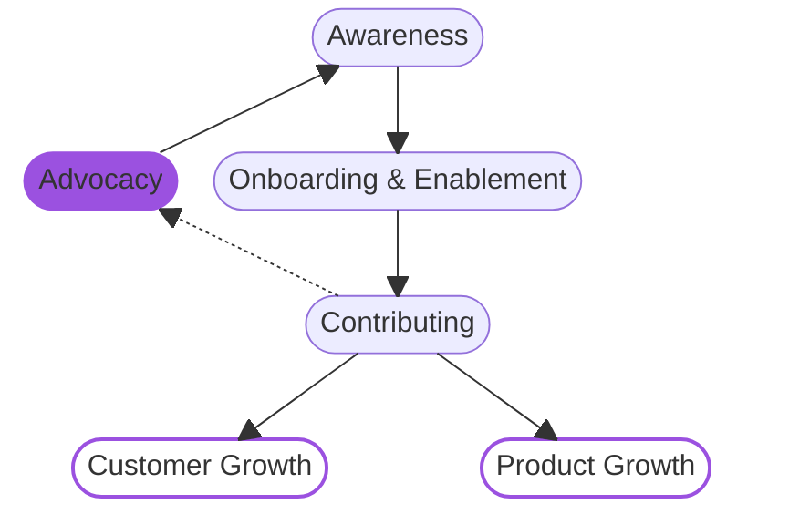

## 共通リンク {#common-links}

|  | |
|-----|-----|
| **GitLab チームハンドル** | [`@gitlab-org/developer-relations/contributor-success`](https://gitlab.com/gitlab-org/developer-relations/contributor-success) |
| **Slack チャンネル** | [`#co-create-and-community-engineering`](https://gitlab.slack.com/archives/C02R0NE6P6C) |
| **チームボード** | [コントリビューターのフライホイールボード](https://flywheel-97bd65.gitlab.io/) |
| **Issue トラッカー** | [`gitlab-org/developer-relations/contributor-success/team-task`](https://gitlab.com/gitlab-org/developer-relations/contributor-success/team-task/-/issues) |

---

## サブページ {#sub-pages}

|  | |
|-----|-----|
| **ワークフロー** | [コントリビューターワークフロー](/handbook/marketing/developer-relations/engineering/community-contributors-workflows) |
| **報告** | [報告と測定](/handbook/marketing/developer-relations/engineering/reporting/) |
| **コントリビューターのユーザージャーニー** | [ユーザージャーニー](/handbook/marketing/developer-relations/engineering/user-journey) |
| **コミュニティペアリングセッション** | [コミュニティペアリングセッション](/handbook/marketing/developer-relations/engineering/community-pairing-sessions) |
| **イノベーションピッチコンペティション** | [イノベーションピッチコンペティション](/handbook/marketing/developer-relations/engineering/innovation-pitch-competition) |
| **あなたのコントリビューションを紹介する** | [あなたのコントリビューションを紹介する](/handbook/marketing/developer-relations/engineering/showcase-your-contributions) |
| **オブザーバビリティアラートのトリアージ** | [コントリビュータープラットフォームのアラートを調査してクローズする方法](/handbook/marketing/developer-relations/engineering/observability-alert-triage) |
| **私たちの仕事の進め方** | [作業の整理、優先順位付け、デリバリー](/handbook/marketing/developer-relations/engineering/how-we-work/) |

---

## 戦略 {#strategy}

コントリビューターのフライホイールは、コントリビューターファネルの各段階における私たちの取り組みを、顧客アカウントと製品の成長につなげます。

### コントリビューターのフライホイール {#contributor-flywheel}

ファネルには、主に次の 3 つの支援領域があります。

1. [認知](https://gitlab.com/groups/gitlab-org/developer-relations/contributor-success/-/work_items/54)：コントリビューションの機会を見つけられるようにします。
1. [オンボーディングとコントリビューション支援](https://gitlab.com/groups/gitlab-org/developer-relations/contributor-success/-/work_items/56)：取り組み始める際の障壁を取り除き、最初の一歩から初回のコントリビューションをやり遂げるまで支援します。
1. [コントリビューション](https://gitlab.com/groups/gitlab-org/developer-relations/contributor-success/-/work_items/57)：価値のあるコントリビューションや協力が続くように支援します。

[アドボカシー](https://gitlab.com/groups/gitlab-org/developer-relations/contributor-success/-/work_items/58)はフライホイールを加速させます。コントリビューターが開催するイベントや作成するコンテンツ、SNS への投稿が認知を広げます。
アドボカシーはコントリビューターのジャーニーのどの段階でも生まれ得ます。
必須の第 4 段階ではありません。

フライホイール全体で、成長の成果とその解釈に役立つ兆候や活動をどのように区別するかは、[報告と測定](/handbook/marketing/developer-relations/engineering/reporting/#measuring-the-flywheel)を参照してください。

## ミッション {#mission}

想像力の速さで共創します。
私たちはコントリビューターの参加を促す取り組みを主導し、私たちと一緒に GitLab を共創するお客様を支援するとともに、そうしたお客様を呼び込みます。また、技術面とプロセス面の改善を通じて、コントリビューターの体験を向上させます。
これは、[**すべてのチームが想像力の速さで信頼できるソフトウェアをリリースできるようにする**](/handbook/company/mission/)という GitLab のミッションと、[社内向けの 3 年間の会社戦略](https://internal.gitlab.com/handbook/company/three-year-strategy/)に沿っています。

### ノーススター {#north-star}

私たちのノーススターは、次の 2 つの成果を通じて、お客様やコミュニティと生み出す価値を高めることです。

- [顧客アカウントの成長](https://gitlab.com/groups/gitlab-org/developer-relations/contributor-success/-/work_items/35)：共創を通じた既存顧客での拡大案件のパイプライン。
- [製品の成長](https://gitlab.com/groups/gitlab-org/developer-relations/contributor-success/-/work_items/36)：価値のあるコントリビューション。

### FY28 の方向性 {#fy28-direction}

FY28 の取り組みでは、ファネルの各段階をこれら 2 つの成果につなげます。
これまでの計画で掲げた数値目標は、更新後の成果に照らして再確認する必要があります。

#### Co-Create: お客様との共創によるアカウントの成長 {#co-create-with-customers-to-grow-accounts}

お客様と共に構築する取り組みを、持続的なアカウント拡大につなげます。

- **成果：** [顧客アカウントの成長](https://gitlab.com/groups/gitlab-org/developer-relations/contributor-success/-/work_items/35)。
  アトリビューション（共創が創出した案件と、共創が影響を与えた案件の区別）、測定対象期間、基準値、目標値を策定中です。

#### コミュニティとの共創による製品価値の向上 {#co-create-with-the-community-to-add-value-to-the-product}

コントリビューターが提供する再利用可能な製品価値を増やし、より速く提供します。

- **成果：** [製品の成長](https://gitlab.com/groups/gitlab-org/developer-relations/contributor-success/-/work_items/36)。
  価値の定義、対象とするコントリビューションの範囲、指標、基準値、目標値を策定中です。
  コントリビューションの件数と SHIP Time は、価値を評価する際の参考情報です。それだけで価値を立証することはできません。

## チームの責務 {#team-responsibilities}

以下は、コントリビューターのフライホイールと 2 つの成長の成果を支える主な責務です。

- コントリビューターの参加を促す取り組みを主導し、コミュニティからの価値あるコントリビューションを増やす。
- 私たちと一緒に GitLab を共創するお客様を支援し、惹きつける。
- 技術面とプロセス面の改善を通じてコントリビューションプロセスの効率を高め、SHIP Time を短縮する。
- コミュニティコントリビューションのエスカレーション先として、コーチング、レビュー、ブロッカーの解消を行い、GitLab の DRI につなぐ。
- 影響力のあるコントリビューターとコントリビューションを表彰する。
- [コントリビュータープラットフォーム](https://contributors.gitlab.com)と、コントリビューションを前進させるツールを構築・運用する。
- 私たちの [Marketing のカウンターパート](/handbook/marketing/developer-relations/)、[Core team](https://about.gitlab.com/community/core-team/)、Product、Engineering と連携する。

これらの責務の運用上の詳細は、サブページの[コントリビューターワークフロー](/handbook/marketing/developer-relations/engineering/community-contributors-workflows)に記載されています。

## Co-Create プログラム {#co-create-program}

GitLab の [Co-Create プログラム](https://about.gitlab.com/community/co-create/)は、Product および Engineering と連携して Co-Create & Community Engineering チームが主導する、部門横断的な取り組みです。
お客様との共創による顧客アカウントの成長と、コミュニティとの共創による製品価値の向上という 2 つの取り組みを含みます。
Co-Create エンゲージメントは、お客様とパートナーが支援を受けながらコントリビュートするための取り組みです。
GitLab 固有のより詳しい手順は、私たちの [Co-Create のハンドブックページ](/handbook/marketing/developer-relations/programs/cocreate/)に記載されています。

## チームメンバー {#team-members}



## コントリビュータープラットフォーム {#contributor-platform}

私たちの[コントリビュータープラットフォーム](https://contributors.gitlab.com)は、GitLab へのオープンソースコントリビューターとコミュニティ活動の中心的なハブです。
複数のプラットフォームからコントリビューションデータを取り込んでおり、[contributors-gitlab-com プロジェクトの README](https://contributors.gitlab.com/docs/README)に詳細を記載しています。

[@leetickett-gitlab](https://gitlab.com/leetickett-gitlab) が技術およびエンジニアリングの DRI です。

## 私たちの仕事の進め方 {#how-we-work}

{}{}{}{}

作業を追跡する場所、エピックと Issue の整理方法、影響と工数の評価、優先順位付け、デリバリーについては、[私たちの仕事の進め方](/handbook/marketing/developer-relations/engineering/how-we-work/)を参照してください。

## 報告 {#reporting}

{}{}{}{}

成長の成果、その解釈に役立つ兆候、報告のカテゴリと担当者、指標やダッシュボードの参照先については、[報告と測定](/handbook/marketing/developer-relations/engineering/reporting/)を参照してください。

## 私たちの作業計画の立て方 {#how-we-plan-work}

計画とワークフローについては、[評価と優先順位付け](/handbook/marketing/developer-relations/engineering/how-we-work/#assess-and-prioritise)と[作業のデリバリー](/handbook/marketing/developer-relations/engineering/how-we-work/#deliver-work)を参照してください。
四半期ごとのレトロスペクティブとチームのスタンドアップについては、[チームの定例活動](/handbook/marketing/developer-relations/engineering/how-we-work/#team-cadence)を参照してください。
