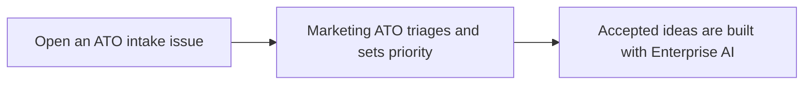
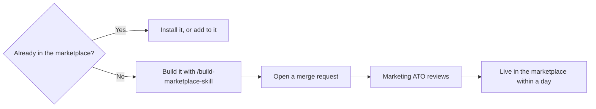
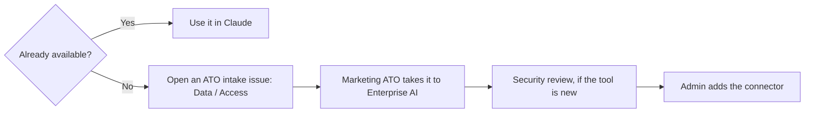

## 概要 {#overview}

このページでは、Marketing のチームメンバーから特によく寄せられる質問を扱います。

1. [AI のアイデアを提出する](#submit-an-ai-idea)
1. [AI Marketplace にスキルやプラグインを追加する](#add-a-skill-or-plugin-to-the-ai-marketplace)
1. [Claude での MCP 接続や API 接続を申請する](#request-an-mcp-or-api-connection-in-claude)
1. [役割と責任](#roles-and-responsibilities)：Marketing の AI の取り組みを誰が所有、構築、承認するか

これらはすべて、GitLab の [Hub & Spoke & Hub](/handbook/eta/ai/strategy/hub-and-spoke/) モデルに従います。Enterprise AI は、プラットフォーム、ガバナンス、セキュリティレビューを担当します。Marketing の [AI Transformation Owner（ATO）](/handbook/eta/ai/strategy/hub-and-spoke/ato/)は、Marketing のどの問題を AI で解決するか、その順序とともに決定します。

質問は、Slack の [#ai-in-marketing](https://gitlab.slack.com/archives/C07GGMS6C57) で尋ねてください。

## AI のアイデアを提出する {#submit-an-ai-idea}

新しいユースケース、プロジェクトの作業、または AI で解決できると考える問題には、この手順を使います。すべてのアイデアは Issue として始まり、Marketing ATO がトリアージします。アイデアは最初に ATO に提出し、Enterprise AI に直接提出することはありません。

1. ATO Intake Request テンプレートを使って、**[ATO 受付 Issue](https://gitlab.com/gitlab-com/eta/ent-ai/hub-spoke-hub/ato-ops/-/issues/new?issuable_template=ato_intake_request)を作成します**（社内限定）。
1. **ツールではなく、問題を説明します。** テンプレートでは、事業上の問題、望む成果とその測定方法、現在の作業方法、実施しない場合の影響、スケジュールを尋ねます。数値を添えたアイデアは、優先順位を付けやすくなります。
1. **Marketing ATO がトリアージします。** ATO は、あなたと内容を明確にし、優先順位を設定して、Enterprise AI とともに進めるか、進めない理由を説明します。ステータスは Issue で追跡できます。

バグ、セキュリティ上の問題、プラットフォームへのフィードバックには、Issue は不要です。Slack の `#ent-ai-champions` に投稿してください。

**詳細：**

- 各種のリクエストの提出先については、[運用サイクル：振り分けルール](/handbook/eta/ai/strategy/hub-and-spoke/operating-rhythm/#champion-model)
- ATO の担当範囲については、[AI Transformation Owner](/handbook/eta/ai/strategy/hub-and-spoke/ato/)

## AI Marketplace にスキルやプラグインを追加する {#add-a-skill-or-plugin-to-the-ai-marketplace}

AI Marketplace は、GitLab のチームメンバーが Claude のスキルやプラグインを共有し、誰もがそれらを見つけてインストールできる場所です。スキルは、毎回同じ方法で行う 1 つのタスクを Claude に教えます。プラグインは、ある役割に関連するスキルをまとめたもので、1 回のインストールですべてを利用できます。

全社向けのプラグインは、マーケットプレイスの [`global/`](https://gitlab.com/gitlab-com/marketplace/-/tree/main/global) フォルダー（社内限定）にあり、すでにすべてのチームメンバーにインストールされています。`/build-marketplace-skill` もその 1 つです。ブランド、デザインシステム、検索コンテンツなど、GitLab の全員が対象のプラグインだけを `global/` に配置します。Marketing のプロセスを支援するスキルは、汎用ツールに見えても Marketing のプラグインに配置します。

自分用のスキルは承認なしで作成できます。チームが依存するようになれば、それは共有プロセスになるため、マーケットプレイスとそのレビューを通します。理由については、[プロンプトはプロセス](/handbook/eta/ai/strategy/prompts-are-process/)を参照してください。

1. **既存のものを確認します。** [AI Marketplace](https://marketplace.entai.gtlb.com/)（社内限定）を確認します。すでに目的を果たすプラグインがあれば、それをインストールするか、そのプラグインにスキルを追加します。
1. **作成します。** Claude で [`/build-marketplace-skill`](https://marketplace.entai.gtlb.com/#/explore/global%2Fmarketplace%2Fbuild-marketplace-skill) と入力します。類似のスキルの確認、プラグインフォルダーの設定、マーケットプレイスの基準に沿ったスキルの作成を支援し、マージリクエストを作成します。
1. **[AI Marketplace リポジトリ](https://gitlab.com/gitlab-com/marketplace)（社内限定）にマージリクエストを作成します**。
1. **レビューします。** Marketing ATO が `marketing/` ディレクトリ内のスキルをレビューします。新しいプラグインや、MCP サーバー、フック、エージェントなど影響の大きいコンポーネントは、AI Marketplace のメンテナーによるレビューも必要です。
1. **公開します。** マージされると、1 日以内に AI Marketplace に表示されます。

スキルのアイデアはあるものの、自分では作成しない場合は、**Plugin or skill idea** テンプレートを使って[マーケットプレイスに Issue を作成してください](https://gitlab.com/gitlab-com/marketplace/-/issues/new?issuable_template=Plugin%20or%20skill%20idea)（社内限定）。

**詳細：**

- [Claude のスキルとプラグインの貢献ガイド](https://internal.gitlab.com/handbook/eta/ent-ai/claude-skills)（社内限定）
- テンプレート、規約、レビューの振り分けについては、[AI Marketplace 貢献ガイド](https://gitlab.com/gitlab-com/marketplace/-/blob/main/CONTRIBUTING.md)（社内限定）
- [プロンプトはプロセス](/handbook/eta/ai/strategy/prompts-are-process/)

## Claude での MCP 接続や API 接続を申請する {#request-an-mcp-or-api-connection-in-claude}

コネクター（MCP サーバーや API 接続）を使うと、Claude が Salesforce や Marketo など別のツールから情報を読み取ったり、そこで操作したりできます。Claude の管理者がコネクターを一元的に追加し、それぞれを利用できる役割を決めるため、自分でチーム用のコネクターを追加することはできません。

1. **すでに存在していないか確認します。** Claude ですでに利用できるコネクターを確認し、[AI Marketplace](https://marketplace.entai.gtlb.com/)（社内限定）で目的を果たすプラグインがないか調べます。
1. **[ATO 受付 Issue](https://gitlab.com/gitlab-com/eta/ent-ai/hub-spoke-hub/ato-ops/-/issues/new?issuable_template=ato_intake_request)を作成し**（社内限定）、リクエストの種類に **Data / Access** を選びます。ツール名、Claude が読み取りまたは変更するデータ、それによって可能になるタスクを記載します。
1. **Marketing ATO が管理者向けのリクエストとして** Enterprise AI に引き継ぎます。
1. **新しいツールには、まずセキュリティレビューが必要です。** ツール、または利用したい AI 機能が [Tech Stack](https://techstack.gtlb.com/)（社内限定）ですでに承認されていない場合、接続する前にセキュリティとプライバシーのレビューを受けます。該当する場合は ATO が知らせます。

未レビューの MCP サーバーを自分で Claude Code に追加しないでください。そのレビューを迂回してしまうためです。Claude は Orange 以下のデータについて承認されているため、Red データを Claude に取り込むコネクターを申請しないでください。

**詳細：**

- Claude の承認範囲については、[GitLab での Claude](/handbook/eta/ai/tools/claude/)
- [データ分類標準](/handbook/security/policies_and_standards/data-classification-standard/)

## 役割と責任 {#roles-and-responsibilities}

Marketing は、*どの* AI の取り組みを実施するかと、*なぜ*実施するかを担当します。Enterprise AI は、*どのように*構築し、ガバナンスを適用するかを担当します。このセクションでは、[Hub & Spoke & Hub](/handbook/eta/ai/strategy/hub-and-spoke/) モデルを Marketing に適用し、すべての AI リクエストに 1 人のオーナー、1 人の構築担当者、1 人の承認者を置きます。

### 役割 {#roles}

| 役割 | 担当すること | 担当しないこと |
|---|---|---|
| **VP, Growth Marketing**（Exec Sponsor） | Marketing の AI の優先事項と、AI の取り組みを評価する事業指標です。リソースを割り当てる前に、大規模な依頼や部門横断の依頼を承認します。経営陣に対して Marketing の AI の取り組みを推進します。 | 日々のトリアージや技術的なアプローチ |
| **Director, Enterprise AI**（Platform Hub のリード） | 全社で承認された AI ツールと共有コンポーネント（プラグイン、スキル、MCP コネクター）、ツールの選定、標準、ベストプラクティスです。セキュリティ、データ、ガバナンスのレビューも担当します。Enterprise AI Engineer を Marketing に割り当て、部門横断の構築を担当します。 | Marketing 内のユースケースの優先順位付け |
| **Director, Marketing Engineering & Operations**（部門内のデリバリーリード） | ATO、Marketing Engineering、Marketing Operations を管理します。AI ロードマップに各チームの稼働を割り当て、構築の担当範囲に関する判断を下します。 | プラットフォーム、ツール、ガバナンスに関する決定 |
| **[Marketing AI Transformation Owner（ATO）](/handbook/eta/ai/strategy/hub-and-spoke/ato/)**（Spoke） | Marketing の AI ロードマップです。ユースケースの適格性と優先順位を判断し、既存のものを確認し、構築担当者を推薦し、部門内の構築を実施前に審査し、リクエストをトリアージし、Champions を選び、オフィスアワーを開催し、Exec Sponsor に価値を報告します。 | プラットフォーム、ツールの選定、すべてを自ら構築すること |
| **Marketing Engineering**（部門内の主な構築担当） | Marketing のエコシステム内で、スキル、プラグイン、エージェント、連携などの AI ソリューションを構築し、保守します。依頼に応じて、Marketing Operations のツール内で技術的に複雑な構築を引き受けます。構築したものをサポートします。 | — |
| **Marketing Operations**（マーケティングテクノロジーとプロセスのオーナー） | [管理するマーケティングテクノロジーツール](/handbook/marketing/marketing-operations/#marketing-technology-stack)の設定、データアクセス、連携の承認を担当します。それらのツール内で AI を構築します。ATO が再設計するマーケティングプロセスを所有します。 | — |
| **Enterprise AI Engineer**（Marketing に割り当てられた Hub の構築担当） | ATO とともにユースケースを探索し、プロトタイプを作成します。部門横断のソリューションを構築し、構築したものをサポートします。 | — |
| **Champions** | Marketing の各サブチームに 1 人配置します。ユースケースを見いだし、試行し、チームメンバーを指導し、バグを報告します。 | — |

### 誰が何を構築するか {#who-builds-what}

Director, Marketing Engineering & Operations は、次のルールで構築担当者を割り当てます。技術的なアプローチは、どの場合も Enterprise AI が定めます。構築に着手する前に、ATO が既存のものを確認します。

| 作業の範囲… | 構築担当 | 相談先 |
|---|---|---|
| Marketing Operations が所有するマーケティングテクノロジーツール内 | Marketing Operations | 技術的に複雑な場合は Marketing Engineering |
| 1 つの Marketing Operations のツールを超える、Marketing のエコシステム内 | Marketing Engineering | Marketing Operations、Enterprise AI Engineer |
| 部門横断（Marketing と他部門） | Enterprise AI Engineer | Marketing Engineering、Marketing Operations |

### RACI {#raci}

各活動の最終責任者は必ず 1 人です。**R** = 作業を実行する · **A** = 承認し、成果に責任を持つ · **C** = 意見を提供する · **I** = 情報共有を受ける。

| 活動 | VP, Growth Marketing | Director, Enterprise AI | Director, Mktg Eng & Ops | Marketing ATO | Marketing Engineering | Marketing Operations | Enterprise AI Engineer |
|---|---|---|---|---|---|---|---|
| Marketing の AI の優先事項と成功指標を定める | A | I | C | R | | | |
| Marketing の AI ロードマップを所有し、優先順位を付ける | C | I | C | A/R | C | C | |
| 大規模な依頼や部門横断の依頼を承認する | A | C | C | R | | | |
| Mktg Eng と Marketing Operations の稼働を割り当てる | I | | A/R | C | | | |
| 技術的なアプローチとベストプラクティスを定める | | A | C | C | C | C | R |
| プラットフォームとツールを選定する | | A/R | C | C | C | | |
| セキュリティ、データ、ガバナンスをレビューする | | A/R | I | I | C | C | |
| Marketing Operations が所有するマーケティングテクノロジーツール内で構築する | | I | A | I | C | R | C |
| Marketing のエコシステム内で構築する | | I | A | I | R | C | C |
| 部門横断のソリューションを構築する | I | A | C | C | C | C | R |
| 部門内の構築が方針に沿っているか実施前に審査する | | C | I | A/R | I | I | |
| マーケティングテクノロジーのデータアクセスと連携を承認する | | C | A | I | C | R | |
| AI でマーケティングプロセスを再設計する | I | | A | R | C | C | C |
| Champions を選ぶ | | | C | A/R | C | C | |
| 価値を報告する | I | C | C | A/R | | | |

### エスカレーション {#escalation}

- **ユースケースのリクエスト**は ATO に提出し、Enterprise AI に直接提出することはありません。[AI のアイデアを提出する](#submit-an-ai-idea)を参照してください。
- **バグ、セキュリティ上の問題、プラットフォームの障害**は、`#ent-ai-champions` または Serval を通じて Enterprise AI に直接連絡します。
- **構築の担当範囲や稼働配分に関する対立**は、Director, Marketing Engineering & Operations に連絡し、次に Exec Sponsor に連絡します。

このセクションは、四半期ごと、またはチーム体制が変わったときにレビューします。
