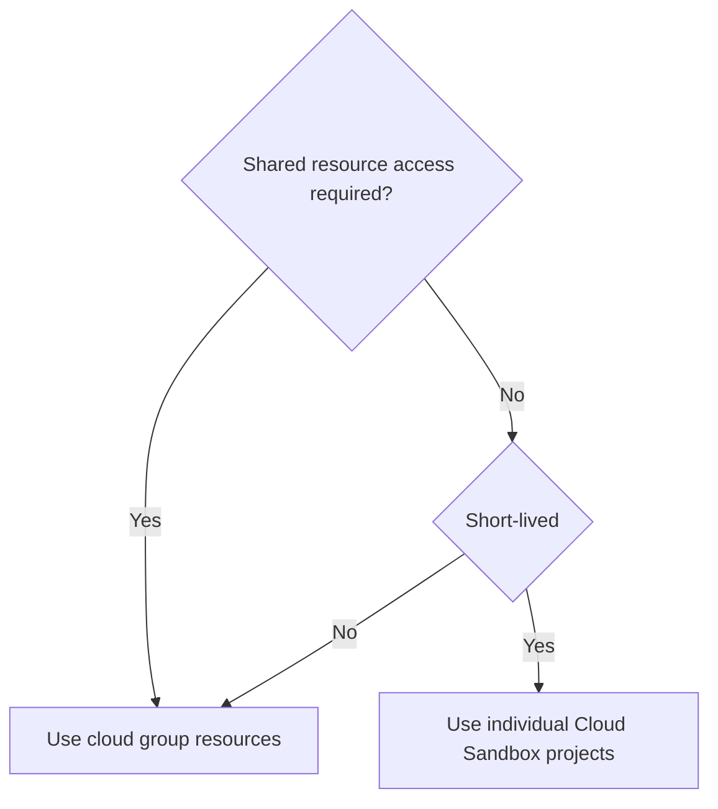

このページでは、GitLab の Developer Advocacy チームが使うクラウドリソースとワークフローの概要を説明します。リソースを効果的に管理・割り当てるためのガイダンスを提供し、長期的な本番環境と個人の短期的なリソースの両方でベストプラクティスを維持しながら、チームメンバーがコミュニティプロジェクトにクラウドインフラストラクチャーを活用できるようにします。

## クラウドリソース {#cloud-resources}

DRI は Developer Advocacy（GCP 管理者）で、Co-Create & Community Engineering と共有しています。

### Google Cloud リソース {#google-cloud-resources}

Google Cloud プロジェクト `group-community-a29572` は、次の用途に使います。

| 名前 | 種類 | 範囲 | チーム | リソース | 注記 |
|------|-------|------|------|-----------|-------|
| デモプロジェクト | デモ | テスト/ステージング | Developer Advocacy | GKE クラスター、VM、DNS  | [ハンドブック](/handbook/marketing/product-and-technical-marketing/developer-advocacy/projects/#project-resources) |

プロビジョニングされると、[Google Cloud Console](https://console.cloud.google.com/)でプロジェクトにアクセスできます。以下のリンクからすばやくアクセスできます。

1. [Compute の概要](https://console.cloud.google.com/compute/overview)
1. [Kubernetes Engine](https://console.cloud.google.com/kubernetes/list/overview)
1. [Cloud Run](https://console.cloud.google.com/run)
1. [SQL](https://console.cloud.google.com/sql/instances)
1. [Cloud Storage](https://console.cloud.google.com/storage/browser)
1. [IAM & Admin](https://console.cloud.google.com/iam-admin/iam)

技術的なオーナーは @johncoghlan @dnsmichi です。

## ワークフロー {#workflow}

1. すべての Developer Relations チームメンバーは、`Editor` ロールを使い、Google Cloud の [community-group プロジェクト](https://console.cloud.google.com/kubernetes/list/overview?hl=en&project=group-community-a29572)でリソースを管理できます。
   - このアクセスはデフォルトではプロビジョニングされません。チームメンバーを追加・削除するには、[アクセスリクエスト](/handbook/eta/corporate-it/end-user-services/access-requests/access-requests/)を作成してください（例として[グループ更新 AR](https://gitlab.com/gitlab-com/team-member-epics/access-requests/-/issues/13320)を参照）。
1. Google Cloud/AWS では、[商標登録されていないドメインを登録](https://internal.gitlab.com/handbook/security/product_security/infrastructure_security/guides/domains-dns/#non-trademark-domain-names)（社内限定）し、そのドメインをデモ環境に使うこともできます。

### デモ環境 {#demo-environments}

顧客向けのデモ環境については、新しい環境を作成する前に既存のリソースを確認してください。

1. [デモシステムのハンドブック](/handbook/customer-experience/demo-systems/)にある [GitLab Learn Labs](https://gitlab.com/gitlab-learn-labs)。
1. [Developer Advocacy コンテンツのハンドブック](/handbook/marketing/product-and-technical-marketing/developer-advocacy/content/)にあるプロダクトツアー、クリックスルーデモ、ワークショップなど。

### 長期的な本番環境 {#long-term-production-environments}

デプロイメントのデバッグが必要なデモには、Google Cloud などの共有リソースを優先してください。

1. SSO ログインで利用できない場合は、1Password ボールトにアクセス方法を記録します。
1. 必要ないリソース（アイドル状態の Kubernetes クラスターなど）はシャットダウンします。

### 個人の短期的なリソース {#individual-short-lived-resources}

ブログ投稿用の個別の短期チュートリアルやデモ環境には、AWS または GCP 向けの [Cloud Sandbox Realm](/handbook/company/infrastructure-standards/realms/sandbox/#how-to-get-started)を優先してください。自動シャットダウンや、アクセスを容易にするドメインの生成などの機能を利用できます。

### 意思決定ワークフロー {#decision-workflow}

