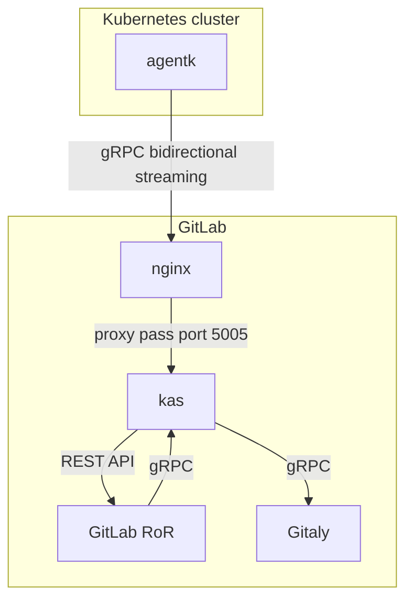
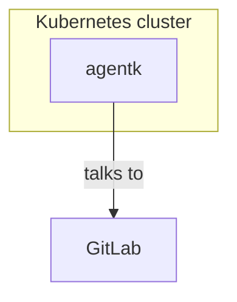

## TL;DR

非常に短くまとめると：

脅威モデリングは開発プロセスのほぼあらゆる時点で行うべきであり、また行うことができますが、本当はプロセスの早い段階で始めるべきです。「何がうまくいかないか」あるいは攻撃者のメンタリティを取り入れて、自分の機能に適用してください。

せっかちな方のために、おそらく最も短い脅威モデリングガイドを示します：

- 機能のダイアグラムを描き、次の点を指摘します：
  - 信頼できない入力はどこから来ますか？
  - 異なる信頼レベルのゾーンはどこにあり、それらの間の信頼境界はどこですか？
- 攻撃者の視点を取り、最悪のケースを想定して脅威を定義します。
  - 最も発生しやすく影響力のある脅威から順に並べてみてください。
- 脅威を文書化し、機能にマップします。直接的に責任を持つ個人と期日を定めたフォローアップ Issue を作成します。

{}
[Threat Model Agent](#threat-model-agent)は、新しい脅威モデルの作成と既存モデルの変更のための主要な手段です。プロセス全体を案内し、私たちのドキュメント要件を満たし、AppSec レビュー用の Draft マージリクエストを作成します。まずこのエージェントを使用してください。このガイドの残りの部分では、エージェントの出力をレビューし、拡充できるよう、各ステップの根拠を説明します。
{}

## Threat Model Agent {#threat-model-agent}

### 目的

Threat Model Agent は、GitLab チームメンバーが自分で脅威モデルの作成、レビュー、改善を行うのを支援する、AI を活用した Application Security アシスタントです。STRIDE 分類と 22 項目のコンプライアンスチェックリストを備えた[エビデンス駆動の PASTA フレームワーク](_index.md#the-framework)を適用し、3 つのワークフローをサポートします。

- 新しい脅威モデルをゼロから作成する
- 既存の脅威モデルをレビューし、拡充する
- 既存の脅威モデルが AppSec レビューを受ける準備が整っているかを検証する

最終版の脅威モデルは [threat-models リポジトリ](https://gitlab.com/gitlab-com/gl-security/product-security/appsec/threat-models)（内部リンク）に保存されます。

{}
LLM ベースのエージェントは、脅威モデルの作成や評価に役立ちますが、人間の判断に代わるものではなく、脅威モデリングプロセスを促進・支援するツールとして捉えてください。自動化された手段だけで脅威を特定するのは非常に難しい場合がありますが、このアプローチにより、チームメンバーはゼロから作業を始めずに済みます。また、脅威モデルが私たちのドキュメント要件を一貫して満たし、組織全体で統一された標準を維持することも保証します。さらに、初期結果を素早く得られ、それを時間をかけてイテレーションし、改善できます。
ただし、エージェントの出力がそのまま最終版になることはありません。レビューは 2 段階で行います。

- まず、自分と機能チームでエージェントの出力を検証します。分解した内容を実際の機能の動作と照合し、偽陽性を取り除き、見落とされた脅威を追加します。
- 次に、AppSec チームが最終版のマージリクエストをレビューします。第 1 段階は作成者である自分の責任であり、第 2 段階がその代わりになるわけではありません。
{}

### 利用可能な場所

エージェントは現在、[threat-models リポジトリ](https://gitlab.com/gitlab-com/gl-security/product-security/appsec/threat-models)内でのみ有効になっています。これは初期ロールアウト中の意図的な設計上の決定です。他の GitLab プロジェクトからのアクセスは今後予定されています。

### モデルの選択

エージェントは、Duo Chat で選択したモデルを使用します。特に複雑な機能については、**Threat Model Agent に切り替える前に、少なくとも Opus 5 を選択してください**。小さいモデルでは、脅威のカバレッジが明らかに低下します。

### セッションの開始

[threat-models リポジトリ](https://gitlab.com/gitlab-com/gl-security/product-security/appsec/threat-models)で Threat Model Agent を選択し、たとえば次のように目標を説明して会話を開始します。

- 「機能 X の新しい脅威モデルを作成したいです。」
- 「この既存の脅威モデルをレビューしてください：」

本格的なセッションを始める前に、概念的な質問をすることもできます（例：「要件 D5b は何を意味しますか？」）。プロセス、要件、用語について不明な点があれば、エージェントに直接尋ねてください。個々の要件、エージェントが推定した重大度分類、STRIDE のカテゴリ、機能のスコープ設定方法を説明できます。

### ゼロから脅威モデルを作成する

新しい脅威モデルを作成したいことをエージェントに伝えます。エージェントは構造化された確認の対話を通じて案内し、機能の背景情報を尋ね、Mermaid データフロー図、脅威表、データ分類を含む文書のドラフトを作成します。各脅威を含める前に、自分で確認します。

### 既存の脅威モデルの変更

新しいモデルの作成だけでなく、更新にもエージェントを使用してください。機能が変わった場合、デプロイの状況が変わった場合、レビューで不足が指摘された場合には、脅威モデルを見直す必要があります。

既存の脅威モデルをリンク、ファイル、テキストとして共有し、必要な作業をエージェントに伝えます。

- **拡充**：新たに追加された機能や、変更された信頼境界に関する脅威を追加します。
- **コンプライアンスチェック**：22 項目のチェックリストに照らして文書を採点し、不足点を優先順位付きで返します。
- **検証**：モデルが完全であり、AppSec レビューを受ける準備ができているかを確認します。

エージェントは内容の弱い脅威や重複する脅威を指摘し、不足する脅威を提案し、カバレッジスコアと優先順位付きの改善案を返します。Draft MR がすでにある場合は、レビュー履歴を保持するため、同じブランチに変更をコミットします。

### エージェントとドラフトを改善する

ドラフトの作成または拡充の後、エージェントは共同で改善するループに入り、最終化の前に偽陽性の削除、前提の見直し、背景情報の追加ができます。すべての改善は同じ会話内で行います。

この改善作業が、上記で説明した作成者側の検証です。最終版のマージリクエストに対して行われる AppSec レビューとは別のものです。

### 保存場所：必ず確認する

エージェントは、プロジェクトのネームスペースと機能の種類に基づき、threat-models リポジトリ内の脅威モデルファイルの保存場所を自動で決定します。通常は正しい場所を選びますが、最終的な Draft MR のファイルパスを必ず再確認してください。場所が違う場合は、正しい保存先をエージェントに伝えると、同じブランチ上でファイルを移動します。

### Draft MR による一時停止と再開

プロセスはいつでも中断し、同じチャットセッション、または作業を保存した Draft MR から後で再開できます。チャットセッションはタイムアウトする可能性があるため、セッションだけに頼らないでください（[セッションのタイムアウト](#session-timeouts)を参照）。MR は常に Draft モードで、自分が明示的に確認した後にのみ作成されます。

一時停止と再開のワークフローは次のとおりです。

1. **セッションの途中で一時停止する**：必要に応じていつでも会話を停止できます。チャットセッションが新しいメッセージを受け付ける間は、途中の回答と確認済みの脅威が保持されます。
2. **作業を Draft MR に保存する**：保存できるだけの内容ができたら、threat-models リポジトリに Draft MR を作成するようエージェントに依頼します。エージェントはプロジェクトのデフォルトブランチを検出し、ネームスペースに対応する正しいパスに文書を保存し、元の Issue へのリンクを付け、MR の説明にセッションメトリクスのブロックを追加します。マージ前に、選ばれたパスを確認してください。
3. **後で再開する**：エージェントとの新しいチャットを開き、Draft MR のリンクを共有します。エージェントは既存の文書を引き継ぎ、追加の検証や改善の入力として扱います。
4. **同じブランチでイテレーションする**：追加の変更を行う場合、エージェントは新しいブランチの作成や MR のクローズ・再オープンをせず、同じブランチのコミットを修正または追加します。これによりレビュー履歴を整理した状態で保てます。
5. **最終化する**：文書が完成したと自分とチームで判断したら、Draft ステータスを外し、MR の担当者は脅威モデルの作成者のままにして、AppSec チームにレビューを依頼します。

Draft MR は作業中の脅威モデルを継続的に保存する場所となるため、機能の設計が進むにつれて、後から戻って作業できます。

#### セッションのタイムアウト {#session-timeouts}

チャットセッションは警告なくタイムアウトする場合があります。その場合、履歴は引き続き表示されますが、メッセージの送信やそのセッションの再開はできなくなります。AppSec チームは、この制限を制御していません。

失う作業を最小限にするため、次のようにしてください。

- 保存する価値のある内容ができたら、すぐに Draft MR を作成するようエージェントに依頼し、作業を進めながらコミットを続けてください。
- Draft MR を作成する前にセッションがタイムアウトした場合は、会話の記録を Threat Model Agent との新しいチャットにコピーし、そこから続けるよう依頼してください。
- 長時間のセッションが必要な大規模な脅威モデルには、セッションのタイムアウトがない[ローカルの Agent SKILL](#local-agent-skills)の使用を検討してください。

### ローカルの Agent SKILL {#local-agent-skills}

脅威モデルが大きく、チャットセッションで扱うのが実用的でない場合は、脅威モデルの SKILL をローカルで実行できます。[Threat Model Agent リポジトリ](https://gitlab.com/components/agents-and-flows/threat-model-agent/)からダウンロードしてください。ローカル実行にはセッションのタイムアウトがなく、任意のモデルを選択でき、生成プロセスと中間出力を完全に制御できます。その代わり、GitLab との連携と Draft MR の自動作成は利用できなくなるため、ほとんどの作業では引き続き Threat Model Agent を推奨します。

## 脅威モデリングとは何か

私たちの[脅威モデリングのハンドブック](_index.md)ページから最初の文を取って、ここでは短くシンプルに保ちましょう：

> 脅威モデリングとは、確立されたまたは新しい手順を取り上げ、それを潜在的なリスクについて評価するプロセスです。

これはおそらく脅威モデリングの最もハイレベルで抽象的な記述です。それでは、それを実用的に使ってみましょう。私たちは**何か**、つまり確立されたまたは新しいプロセスを取ります。本当に何でも構いません。私たち自身の[アセスメントツール](https://gitlab.com/gitlab-com/people-group/peopleops-eng/assessment-tool/-/blob/master/threat-model.md)、[スタンドアロンの GitLab インスタンス](https://gitlab.com/gitlab-com/gl-security/security-research/gitlab-standalone-instance/-/tree/master#gitlab-standalone-instance)や、[新しいインフラ](https://gitlab.com/gitlab-com/gl-security/product-security/appsec/appsec-reviews/-/issues/79)（内部リンク）のようなものです。

このハウツーの残りの部分では、脅威モデルを作成しようとしている**もの**を**機能**と呼びます。GitLab における脅威モデリングのほとんどが、製品の機能、または SaaS オファリングのインフラの機能について行われるからです。

脅威モデルが行うこと、それは見ている機能を分解し、より多かれ少なかれ形式化された方法で、機能とそのコンポーネントに対する**脅威**を**特定**し記述できるようにすることです。この記述はこれまで非常に形式的に聞こえ、実際に脅威モデルを思いつくのに役立たないかもしれません。何が達成されるべきか（**脅威の特定**）の漠然とした基準として捉え、ここからどうやってそこに至るかを見ていきましょう。

[GitLab で使用される正式なフレームワークは PASTA と呼ばれています](_index.md)。このガイドは、PASTA の原則を、あらゆる GitLab チームメンバーが従うときに最大限の効果を発揮するために、軽量な方法で適用するのに役立ちます。

## いつ、どこから始めるか

「実装しようと計画している機能の脅威モデリングはいつ始めるべきか？」と疑問に思うかもしれません。実際には明らかではありませんが、幸いにも、現在開発中または使用中のあらゆる機能に対して脅威モデルを作成するのに、遅すぎることも早すぎることもありません。また、セキュリティのすべてと同様に、これは固定された永遠の状態というよりは、プロセスです。脅威モデルは、機能が変更された場合、または機能は同じままでも異なるコンテキストや環境で使用される場合に、適応・洗練される必要があります。なので、はい、これはある意味で「追加」の作業です。適切な脅威モデルが自然に生まれるわけではないからです。しかし、それらの追加のステップは、「*何がうまくいかないか*」のモーメント、つまり**脅威**としても知られているもの、についてさらに洞察をもたらすことで、すぐに報われるでしょう。決して遅すぎることはありませんが、プロセスを早く始め、機能の追加や変更に対して脅威モデルを最新の状態に保つほど、より報われるでしょう。これは、安全でない設計上の決定の修正がかなり複雑で、[破壊的](https://gitlab.com/gitlab-com/gl-infra/delivery/-/issues/1518)（内部リンク）であることもあるからです。

## ツール： 🔨と🧠

ほとんどの脅威モデリングフレームワークは、いくつかのダイアグラムが描かれることに依存しており、その周りには非常に重いツールがたくさんあります。そのようなツールは、データフロー図 (DFD) を取り、それが何であるかに基づいて特定のコンポーネントに特定の脅威を自動的にマッピングするでしょう。これは場合によっては非常に有用ですが、GitLab ではより柔軟性が必要です。私たちが見ている機能は、例えば [STRIDE](https://en.wikipedia.org/wiki/STRIDE_(security))ベースの脅威モデリングのような厳格なスキーマにうまく収まらないことが多く、結果として意味のある脅威があまり得られないかもしれません。

### ダイアグラムを描く

ダイアグラムにはほぼ無限の可能性があります。GitLab 内での簡単で統合された使用には、私たちの[サポートされているダイアグラムツール](https://docs.gitlab.com/ee/user/markdown.html#diagrams-and-flowcharts)のいずれかを使うことをお勧めします。ただ、柔軟で正確に保つために、慣れているダイアグラム作成ツールを何でも使えます。機能の正確なダイアグラムを提供できればよいのです。例えば、私たちの [Kubernetes Agent](https://docs.gitlab.com/ee/user/clusters/agent/)のこの mermaid ダイアグラムは、出発点として完全に十分です。これは、すべての関係するコンポーネントを、依然として理解可能で意味のあるレベルで、それらの相互作用と共に示しています。

これをあまりに単純にしてしまうと：

それでも間違いではないでしょうが、これからあまり詳細な脅威を導き出すことはできません。

### 信頼と境界

典型的なアーキテクチャダイアグラムには通常含まれない注目すべきコンポーネントは、**信頼境界** です。信頼境界は Kubernetes Agent ダイアグラムにも明示的には描かれていませんが、私たちはそれを推測できます。信頼境界は、ダイアグラム内で異なるレベルの信頼を持つ部分を分離するものです。Kubernetes Agent のケースでは、これがはっきりと見えます。Kubernetes クラスタはどこにでもあり、誰によっても制御される可能性があり、本当に信頼できるものではありません。しかし、GitLab 制御コンポーネントは GitLab によって制御されており、したがって非常に信頼できます。なので結論として、ダイアグラムのこれら 2 つの部分の間に**信頼境界**があります。これが実際の脅威が登場する部分です。脅威は通常、これらの信頼境界で現れます。この信頼境界を見ただけで思いつく可能性のある最初の脅威：

- `agentk` と `kas` 間の通信は暗号化されていない可能性がある

これは考慮するには非常に単純で一般的なものですが、依然として正当な懸念であり、脅威モデルの最初のステップです。

### 脅威を見つける

より多くの脅威の領域をカバーするために、私たちは「最悪のケース」または「何がうまくいかないか」の態度に少し視点をシフトする必要があります。これは一般的により多くの脅威シナリオを見つけるのに大いに役立ちます。非常に形式化された `STRIDE` のアプローチでは、実際の脅威クラスは次のとおりです：

- `S`poofing （なりすまし）
  - 何か、または誰かになりすますこと
- `T`ampering （改ざん）
  - データやコードを変更すること
- `R`epudiation （否認）
  - アクションを実行していないと主張すること
- `I`nformation disclosure （情報開示）
  - 見ることが許可されていない誰かに情報を公開すること
- `D`enial of Service （サービス拒否）
  - ユーザーへのサービスを拒否したり低下させたりすること
- `E`levation of Privilege （権限昇格）
  - 適切な認可なく能力を獲得すること

そのため `STRIDE` という名前です。私たちは正式な STRIDE フレームワークを使用しませんが、これらの脅威クラスを使用してモデル内の具体的な脅威を定義する際に何を考慮すべきかのアイデアを得ることができます。

なので、Kubernetes Agent の例におけるなりすましは、ある `agentk` が別のものになりすますことができることに現れるかもしれません。上記の「`agentk` と `kas` 間の通信は暗号化されていない可能性がある」の例は、例えば情報開示の脅威クラスに当てはまります。ここでは、起こりうるあらゆる問題を一つ残らず考えることが目的ではありません。可能性のある膨大で、むしろわかりにくい脅威を簡単に思いつくことができますが、それは非常に気を散らし、脅威モデルのポイントを見失うかもしれません。私たちは主に、発生する可能性が高そうな脅威と、発生したときに本当に影響力のある脅威を狙いたいのです。

### .com と セルフマネージド の両方を考慮する

少し枠の外を考えてみてください： 特定の機能は `GitLab.com` ではうまく動作するが、私たちの SaaS プラットフォームとは異なる方法でセットアップされた セルフマネージド 環境ではトラブルや停止を引き起こす可能性があります。これも脅威となり得て、機能の環境的変化によって引き起こされます。これは結論として、機能が使用される環境を常に考慮するべきだということを意味します。その環境は時間とともに、または異なるデプロイメントシナリオで変わる可能性があり、最初から常にフレンドリーで信頼できるとは限りません。

### 不正使用とプラットフォーム悪用を考慮する

無料リソース（コンピューティング分、ストレージ、トライアル延長、レート制限の引き上げ、または何らかのクォータ割り当て）へのアクセスを導入または拡大する機能や製品には、固有の不正使用の表面があります。悪意のあるアクターは、支払うことなく大規模にリソースを取得する方法を積極的に探っています。レビューされている機能が次のいずれかに触れる場合、リソース取得、コスト回避、またはプラットフォーム操作のために悪用される可能性があるかどうかを検討してください：

- 無料層の制限またはトライアル資格ロジック
- CI/CD パイプラインリソース（コンピューティング分、Runner、並列ジョブ）
- AI トークンや LLM クォータの不正使用を可能にする可能性のある DAP 機能フロー（例： 割り当てられた推論クレジットをサードパーティや意図しない LLM 使用にプロキシまたはリダイレクトすること）
- CI 分、プロジェクト/名前空間の作成、または DAP クレジット/トライアルなどのリソース副作用を持つ招待または紹介メカニズム

これらのいずれかの領域で不正使用の可能性を特定した場合は、Trust and Safety チームを早期に巻き込んでください。Slack の `#abuse` で連絡するか、Issue や MR で `@gitlab-com/gl-security/security-operations/trust-and-safety` をタグ付けします。彼らは不正使用のリスクを評価し、検出シグナルに取り組み、必要に応じてローンチ後の計画を調整できます。

### 検出策を考慮する

Signals Engineering は、GitLab SaaS プラットフォーム、クラウド環境、企業システムやアプリケーションを含む GitLab 環境の悪用試行や成功した悪用を特定するための脅威検出を構築する責任があります。脅威モデリング演習中にサイバー脅威リスクが特定された場合、検出事項を Signals Engineering と調整することで、Signals Engineering チームによって構築されたプロアクティブな脅威検出を通じて既知のリスクを軽減するのに役立ちます。

Signals Engineering に連絡する価値のある特定のリスクには以下が含まれます：

- GitLab.com の主要なインフラや機能への根本的な変更
- GitLab 内の新しいクラスの機能/機能性（Duo Agent Platform など）
- 新しいインフラスタック/技術上で動作する新しい GitLab 機能
- 外部統合/攻撃面を導入する新しい GitLab 機能

Signals Engineering に連絡する価値のあるリスクを特定した場合、内部 Slack（`#security_help` で `@signals_engineering` をタグ付け）で連絡するか、[新しい検出バックログ Issue](https://gitlab.com/gitlab-com/gl-security/security-operations/signal-engineering/detection-backlog/-/work_items/new?related_item_id=undefined&type=ISSUE&initialCreationContext=list-route&description_template=New_Detection_Template) （内部リンク）を提出してください。

## 次は何ですか？

最初のステップが完了し、よく考えられた最初の一連の脅威ができたら、機能の開発中にこのリストを使って、私たちが脅威と最悪のケースシナリオと判断したものを軽減できます。

### 脅威モデルの文書化

[Threat Model Agent](#threat-model-agent)は、[AppSec の脅威モデルリポジトリ](https://gitlab.com/gitlab-com/gl-security/product-security/appsec/threat-models)（内部リンク）に文書を書き込み、Draft MR を作成します。マージ前に、選ばれたファイルパスを必ず確認してください。エージェントを使わずに脅威モデルを文書化する場合は、[Threat Model テンプレート](https://gitlab.com/gitlab-com/gl-security/product-security/appsec/threat-models/-/blob/master/.gitlab/issue_templates/Threat%20Model.md)（内部リンク）の構造に従い、マージリクエストとして提出してください。新しい脅威モデルを作成するために Issue を開かないでください。

### 脅威の所有権の確保

脅威モデルが更新されるたびに、それを要約する生きた説明と、各脅威に対する Issue へのリンクを持つ Issue を作成することを検討してください。次のような形です：

| 脅威                                                       | コメント                                                     | テスト / Issue                                                        |
| ------------------------------------------------------------ | ------------------------------------------------------------ | ------------------------------------------------------------ |
| `agentk` と `kas` 間の暗号化されていない通信         |                                                              | ✅ gRPC 通信は TLS 暗号化された WebSocket 経由で行われます (#123 を参照) |
| `agentk` が別のクラスタの `agentk` になりすますことができる可能性がある |                                                              | 認可をレビューするための Issue #124                                   |
| `gitaly` レベルへの攻撃                                    | `agentk` は `kas` 経由で `gitaly` に間接的にアクセスでき、これは インジェクションや [IDOR](https://en.wikipedia.org/wiki/Insecure_direct_object_reference)攻撃に悪用される可能性があります | Issue #125 - `agentk` から `gitaly` に向かうデータフローを確認        |

各脅威には、回避、防止、検出、または回復の提案がチームによって議論される Issue が作成されるべきです。これらの Issue にはアサイニーとマイルストーンまたは期日があるべきです。当初、アサイニーは Project Manager であり、Issue を優先順位付けし、適切に再アサインします。Application Security engineer の役割は、その提案の作成を支援し、チームが Issue を理解して対処できるよう助け、マージ前に脅威がどのように軽減されているかをレビューすることです。

また、現在実装されているリスクを記述していない場合は、これらの Issue を公開することを検討してください。実装のセキュリティ姿勢を改善する方法について議論する Issue は、[デフォルトで公開](/handbook/communication/confidentiality-levels/#internal)にできます。

### イテレーション

脅威モデルは決して本当に完了することはありません。チームは脅威モデルに精通し、新しい機能や変更が発生したら、改めて [AppSec レビュー](/handbook/security/product-security/security-platforms-architecture/application-security/appsec-reviews/)や脅威モデルの更新を依頼してください。更新には [Threat Model Agent](#threat-model-agent)を使用してください。Application Security engineer は、新しい脅威モデルが必要になるときも特定するために、チームと密接に協力するべきです。

### 自分でやる

このガイドの言語の多くは、Application Security engineer がチームと脅威モデリングをどのように行うべきかを記述していますが、そうである必要はありません！セキュリティはみんなの責任で、**あなた**も脅威モデリングできます！助けが必要なら Slack の `#security_help` に連絡してください。
