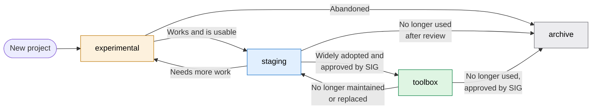

## 概要 {#overview}

[Support Toolbox](https://gitlab.com/gitlab-com/support/toolbox) GitLab グループには、Support チームが自らのために構築したツール、自動化、AI ワークフローを収めています。プロジェクトは 4 つのカテゴリに分かれ、承認済みのもの、使用可能でも未承認のもの、保守されていないものをチームが判断できるようにしています。そのうち 3 つはグループです。

- [Experimental](https://gitlab.com/gitlab-com/support/toolbox/experimental)
- [Staging](https://gitlab.com/gitlab-com/support/toolbox/staging)
- [Toolbox](https://gitlab.com/gitlab-com/support/toolbox)（グループのルート）

Archive はプロジェクトが取り得る状態であり、グループではありません。

[Support Toolbox グループのページ](https://gitlab.com/gitlab-com/support/toolbox)の README には、Support Toolbox のプロジェクトと、目的、所有者、依存関係などの詳細を記載しています。何があるかを調べるには、まずそこを確認してください。

新しいプロジェクトを始める前に、Toolbox と Staging を確認し、目的をすでに果たす既存のツールがないか調べてください。

## ライフサイクル {#lifecycle}

## カテゴリ {#categories}

### Experimental {#experimental}

グループ: [`gitlab-com/support/toolbox/experimental`](https://gitlab.com/gitlab-com/support/toolbox/experimental)

`experimental` サブグループに置く、新しいプロジェクト、プロトタイプ、概念実証です。変更されたり、動かなくなったり、放棄されたりする可能性があります。

### Staging {#staging}

グループ: [`gitlab-com/support/toolbox/staging`](https://gitlab.com/gitlab-com/support/toolbox/staging)

動作するプロジェクトが Experimental を離れた後の、標準的な置き場所です。Staging のプロジェクトは使用可能で、チームが利用できますが、[Support Innovation Group（SIG）](_index.md)の承認は受けていません。

Staging のプロジェクトの中には、利用が広がるにつれて SIG の承認に提出するものもあります。特定のチームメンバー向けのニッチなツールや、より広く利用されているツールと重複するプロジェクトなどは、Staging にとどまります。

### Toolbox {#toolbox}

グループ: [`gitlab-com/support/toolbox`](https://gitlab.com/gitlab-com/support/toolbox)（サブグループではなく、グループのルート）

このグループには、SIG の承認を受け、Support、組織の他部門、または顧客に人気があり、広く使用されているプロジェクトを収めています。次のものが含まれます。

- スケジュール済みまたはトリガーによって実行されるパイプライン、ボット、レポート、Chrome 拡張機能など、Support のワークフローが依存する、稼働中のインテグレーションや CI 自動化を持つプロジェクト。
- エージェントのランタイム、エージェントのスキル、MCP インテグレーション、AI による自動化など、Support が依存する AI ワークフロー。

これらの基準を満たさないプロジェクトは、Toolbox に追加しません。

**Toolbox プロジェクトへの変更は、すべて SIG の承認が必要です。** Toolbox へのプロジェクトの追加、Toolbox からの削除、アーカイブが含まれます。[Toolbox プロジェクトの SIG 承認を申請する](#requesting-sig-approval-for-a-toolbox-project)を参照してください。

### Archive {#archive}

Archive はプロジェクトの状態であり、グループではありません。アーカイブ用のグループはありません。アーカイブされたプロジェクトは GitLab で読み取り専用になり、Experimental、Staging、Toolbox のルートのいずれであっても、元のグループにとどまります。

保守または使用されなくなったプロジェクトをアーカイブしてください。その兆候には、次のようなものがあります。

- 意味のある活動がない
- 実行中の自動化がない
- 別のツールに置き換えられている
- 所有者が退職している

アーカイブされたプロジェクトは、移動も削除もしません。[プロジェクトのアーカイブ](https://docs.gitlab.com/user/project/working_with_projects/#archive-a-project)と[プロジェクトのアーカイブ解除](https://docs.gitlab.com/user/project/working_with_projects/#unarchive-a-project)の方法について、GitLab のドキュメントを参照してください。アーカイブすると、スケジュールされたパイプラインとプルミラーリングも停止し、デプロイされた Pages が削除されます。

## カテゴリ間でプロジェクトを移動する {#moving-projects-between-categories}

| 移動 | 決定者 |
| --- | --- |
| Experimental から Staging、または Staging から Experimental | プロジェクトの所有者。承認は不要です。 |
| Staging から Toolbox、または Toolbox から Staging | SIG が承認します。[Toolbox プロジェクトの SIG 承認を申請する](#requesting-sig-approval-for-a-toolbox-project)を参照してください。 |
| Experimental または Staging から Archive | プロジェクトの所有者、または所有者が退職している場合は Support Leader が、プロジェクトが使用または保守されていないことを示す根拠に基づいて決定し、その後、告知して異議申し立ての期間を設けます。 |
| Toolbox から Archive | SIG の承認後、プロジェクトは[プロジェクトをアーカイブする](#archiving-a-project)の手順に従います。 |

### Toolbox プロジェクトの SIG 承認を申請する {#requesting-sig-approval-for-a-toolbox-project}

SIG が申請を承認する前に、Toolbox プロジェクトを追加、削除、アーカイブしないでください。

1. [SIG Intake Request Form](https://gitlab.com/gitlab-com/support/support-project-portfolio/-/work_items/new?description_template=sig_intake)を使って申請を作成してください。プロジェクト、行いたいこと（追加、削除、アーカイブ）、および Toolbox の基準をどのように満たすか、または満たさなくなった理由を記載してください。
1. SIG が申請をレビューし、[SIG のワークフローと承認プロセス](support-innovation-group.md)を通じて承認するのを待ってください。
1. 承認後、変更を行い、完了したら申請にコメントしてください。
   - **Toolbox に追加する:** Support Leader が、Staging から Toolbox グループのルートへ[プロジェクトを移管](https://docs.gitlab.com/user/project/working_with_projects/#transfer-a-project)します。Toolbox グループにプロジェクトを追加できるのは Support Leader のみであり、その権限があっても SIG の承認に代えることはできません。
   - **Toolbox から削除する:** プロジェクトの所有者または Support Leader が、プロジェクトを Staging グループに移管します。
   - **アーカイブする:** [プロジェクトをアーカイブする](#archiving-a-project)に従ってください。
1. 移管後、古いプロジェクトパスに依存していた CI/CD パイプライン、インテグレーション、リンクを確認してください。

### プロジェクトをアーカイブする {#archiving-a-project}

1. プロジェクトが Toolbox にある場合は、先に [SIG の承認](#requesting-sig-approval-for-a-toolbox-project)を得てください。
1. プロジェクトの最近の活動、実行中の自動化、所有者の状況を確認してください。
1. 日付を添えてアーカイブ対象のリストを告知し、チームが異議を申し立てる時間を設けてください。
1. スケジュールされたパイプラインなど、実行中の自動化を無効にしてください。
1. 告知した日にプロジェクトをアーカイブしてください。
1. 古いプロジェクトパスに依存していた CI/CD パイプライン、インテグレーション、リンクなど、動かなくなったものがあれば報告するようチームに依頼してください。
